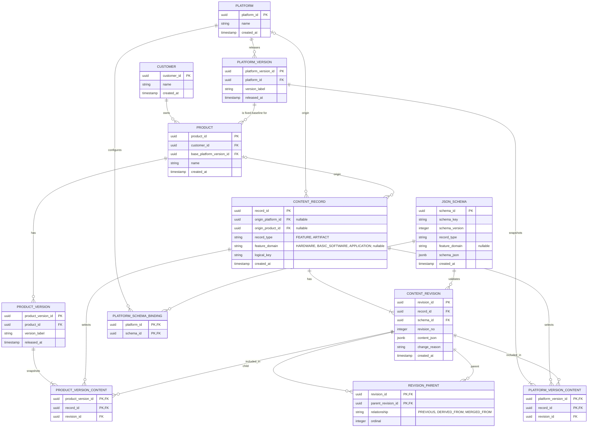

# データベース論理設計

## 設計方針

- 顧客、製品、プラットフォーム、バージョン、レコードの所有関係はリレーショナルに管理する。
- プラットフォームのリリースと製品バージョンは、含めるレコードリビジョンを固定したスナップショットとする。過去のリビジョンは更新・削除せず、変更は新しいリビジョンとして登録する。
- フィーチャーと成果物は `CONTENT_RECORD` と `CONTENT_REVISION` で共通管理する。レコードの内容およびトレーサビリティは `content_json` に保持する。
- フィーチャーは `record_type = FEATURE` とし、`feature_domain` で `HARDWARE`、`BASIC_SOFTWARE`、`APPLICATION` を区別する。各ドメインのフィーチャー構造は、割り当てるJSON Schemaで定義する。
- JSON Schemaは不変のバージョン付き定義として管理する。プラットフォームとスキーマの紐付けを分離することで、同じスキーマを複数プラットフォームで再利用できる。
- 製品は登録時に基準プラットフォームバージョンを必須指定し、以降変更不可とする。製品バージョンは、その基準から継承・選択したフィーチャーと製品固有の追加・変更フィーチャーを含む完全な構成スナップショットとする。
- 顧客入力物のバイナリ本体はオブジェクトストレージに置き、参照キーやメタデータを `content_json` に保持する。

## ER図

## テーブルの役割と制約

| テーブル | 役割 |
|---|---|
| `CUSTOMER` / `PRODUCT` | 顧客と製品を管理する。製品の `base_platform_version_id` は必須で、作成後は変更禁止とする。製品が採用するプラットフォームはこの基準バージョンから一意に決まる。 |
| `PLATFORM` / `PLATFORM_VERSION` | プラットフォームと、変更不能な公開バージョンを管理する。公開時点で `PLATFORM_VERSION_CONTENT` に含有リビジョンを固定する。 |
| `PRODUCT_VERSION` | 顧客製品のリリース／マイルストーンを管理する。`PRODUCT_VERSION_CONTENT` は、その時点で製品に組み込まれた全ての有効リビジョンを固定する。 |
| `CONTENT_RECORD` | フィーチャーと成果物の論理的な識別子を管理する。`origin_platform_id` / `origin_product_id` は作成元の記録であり、利用可能な製品を制限しない。公開・編集中の製品バージョンへの採用は内容テーブルで管理する。 |
| `CONTENT_REVISION` | レコードの不変リビジョンを管理する。`content_json` はJSONBで保持し、各リビジョンは作成時点の `schema_id` を参照する。 |
| `REVISION_PARENT` | 同一レコード内の変更履歴に加え、プラットフォームから製品への派生や、将来の複数元からのマージをリビジョン間の有向関係として記録する。 |
| `JSON_SCHEMA` / `PLATFORM_SCHEMA_BINDING` | レコード種別・フィーチャードメイン別のJSON Schema定義とバージョンを管理し、プラットフォームごとの適用スキーマを設定する。同じスキーマ定義を複数プラットフォームに割り当てられる。 |
| `PLATFORM_VERSION_CONTENT` / `PRODUCT_VERSION_CONTENT` | 各バージョンが参照する正確なリビジョンを固定する。`(version_id, record_id)` を一意とし、1バージョンで同一レコードの採用リビジョンが必ず1つに定まる。同じレコード／リビジョンは複数の製品バージョンから参照できる。製品側は基準プラットフォームから継承したリビジョンと製品固有リビジョンを含む完全な構成マニフェストを保持する。 |

## 整合性ルール

1. `CONTENT_RECORD` は作成元を記録する場合、`origin_platform_id` または `origin_product_id` のちょうど一方を持つ。どちらもNULLなら共有範囲を限定しない共通レコードとする。これらは作成元の情報であり、製品バージョンへの採用可否を決めない。`record_type = FEATURE` の場合は `feature_domain` を必須とし、それ以外ではNULLとする。
2. `CONTENT_REVISION.revision_no` は同一レコード内で一意とする。リビジョン番号とスキーマ定義は後から変更しない。
3. `PLATFORM_VERSION_CONTENT` と `PRODUCT_VERSION_CONTENT` は、リビジョンが属するレコードと一致する `record_id` を保持し、`(version_id, record_id)` を一意にする複合外部キーで整合性を保証する。これにより、ある製品バージョンと成果物レコードから採用リビジョンを一意に取得できる。同一リビジョンを複数の製品バージョンに登録することもできる。
4. 製品バージョンは、基準プラットフォーム由来、当該製品由来、または他製品から再利用・マージされたリビジョンを採用できる。製品固有の変更は新しいリビジョンとして保持し、元となったリビジョンを `REVISION_PARENT` で参照する。採用可能性やアクセス権はMCPサーバーで検証する。
5. フィーチャーの完全な製品構成では、ハードウェア、基本ソフト、アプリケーションのフィーチャーリビジョンを必要に応じて組み合わせる。
6. `content_json` 内のトレーサビリティ参照は、安定したレコードID／リビジョンIDを使用する。JSON Schema検証、参照先の存在・アクセス権検証、製品構成の重複や必須フィーチャー検証はMCPサーバーで行う。DBの外部キーで表現できる顧客・製品・バージョン・リビジョン間の関係は通常の外部キーで保護する。
7. 論理キーの一意性は適切な共有スコープ内で保証する。PostgreSQLでは必要に応じて部分一意インデックス等を用い、NULLを含む複合UNIQUE制約の挙動に依存しない。
8. 公開済みのプラットフォームバージョン、製品バージョン、コンテンツリビジョン、JSON Schema定義は更新・物理削除しない。取り消しや置き換えは新しい版または状態で表現する。

## JSONBの内容例

フィーチャーのJSONBには、フィーチャー固有属性や依存・排他などの関係を格納する。成果物のJSONBには、成果物本体または外部ストレージ参照、入力要求、派生元、関連成果物、変更理由などを格納する。個々の構造はフィーチャードメイン／レコード種別に対応するJSON Schemaで検証する。SYS.1〜SYS.3の成果物スキーマは [json-schema-design.md](./json-schema-design.md) に定義する。

リビジョンの親子関係やバージョンへの採用関係など、履歴検索と整合性が必要な関係はJSONBに埋め込まず、`REVISION_PARENT` および各バージョン内容テーブルに保持する。JSONB内のトレーサビリティは柔軟な詳細情報とし、ID参照をMCPサーバーで検証する。

編集中を含む製品バージョンから成果物とそのトレーサビリティを取得するときは、`PRODUCT_VERSION_CONTENT` を `CONTENT_REVISION` と結合し、製品バージョン内で選択されたリビジョンの `content_json` を読む。同じ成果物レコードのリビジョンを複数の製品バージョンから参照できるため、共有資産を重複登録せずにリリースできる。
