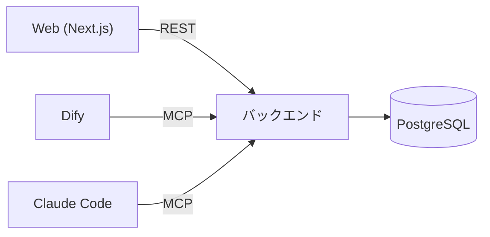

# 開発環境要件

Webアプリケーションから利用するバックエンドを開発するための、本番環境の構成とローカル開発環境の要件を定義する。

## AIへの指示

- 本書に従ってローカル開発環境を構築・保守する。
- 認証情報とデータベース名は `.env` にのみ記載し、本書・compose ファイル・ソースコード・ドキュメントには値を書かない (ENV-019)。
- 本書に記載のないライブラリ・サービスを利用する場合は、実装前にユーザーへ確認する。確認して承認されたものは「[承認済みの追加ライブラリ・サービス](#承認済みの追加ライブラリサービス)」に追記する。
- 要件は ID (`ENV-xxx`) で参照できる。変更時は該当 ID の記述を更新する。
- 手順書は [backend/README.md](../../backend/README.md) にまとめる。リポジトリ直下の `README.md` は変更しない。

## 1. システム構成

### 1.1 本番環境

| 項目 | 内容 |
|---|---|
| Webアプリケーション | Next.js |
| データベース | Amazon RDS for PostgreSQL |
| バックエンド | FastAPI (REST API) と FastMCP (MCP サーバー) |
| 利用者 | Webアプリケーション、Dify、Claude Code |



### 1.2 機能要件

| ID | 要件 |
|---|---|
| ENV-001 | Webアプリケーションは Next.js で構築する。 |
| ENV-002 | バックエンドのデータは Amazon RDS for PostgreSQL に保持する。 |
| ENV-003 | データ取得API: Webアプリケーションが呼び出すと、バックエンドが PostgreSQL のデータを JSON 形式に変換して応答する。 |
| ENV-004 | データ設定API: Webアプリケーションが設定対象の JSON を指定して呼び出すと、バックエンドが DB のレコード形式に変換して PostgreSQL を更新する。 |
| ENV-005 | Dify や Github Copilot / Claude Code が MCP でバックエンドに接続し、バックエンドが提供するAPIを利用できる。 |
| ENV-006 | データベースは、本番 (Amazon RDS for PostgreSQL) とローカルのどちらも PostgreSQL 18 を使用する。 |

## 2. ローカル開発環境の要件

ENV-001〜006 の構成を、AWS を使わずにローカルで再現する。

| ID | 要件 |
|---|---|
| ENV-010 | VS Code と GitHub Copilot を使い、WSL と macOS で構築できる。 |
| ENV-011 | チームの複数人が同じ環境を共有できるよう、Dev Containers と Docker Compose を使用する。 |
| ENV-013 | ローカルの PostgreSQL の初期データは、JSON 形式のファイルで定義できる。 |
| ENV-014 | データベースの内容を簡単に確認できる。 |
| ENV-015 | データベースの内容を、初期投入データとして使える JSON 形式でエクスポートできる。 |
| ENV-016 | リポジトリのルートで `docker compose up` を実行すると、フロントエンド、バックエンド、データベース、各種ツールがすべて起動し、初期データが投入される。 |
| ENV-017 | Compose ファイルはサービスの種類ごとに分割する。Dify など他のサービスを、後から別ファイルとして追加できる。 |
| ENV-018 | 初期のテーブルは [design/database/er-design.md](../database/er-design.md) に従い、Alembic のマイグレーションで作成する。 |
| ENV-019 | 認証情報 (DB のユーザー名・パスワード) とデータベース名は、環境変数ファイル `.env` のみで管理する。`.env` は Git にコミットせず、雛形の `.env.example` をコミットする。compose ファイル、ソースコード、ドキュメントにはこれらの値を書かず、環境変数 (`POSTGRES_USER` / `POSTGRES_PASSWORD` / `POSTGRES_DB`) として参照する。 |
| ENV-020 | `.env` の環境変数を VS Code のターミナルで有効にするため、`.vscode/settings.json` に `"python.terminal.useEnvFile": true` を設定する。 |

## 3. 技術スタック

### 3.1 バックエンド

| パッケージ | 用途 | ライセンス | 商用利用 | ソース公開義務 | 備考 |
|---|---|---|---|---|---|
| FastAPI | Webフレームワーク | MIT | 可能（無償） | なし | 改変・商用配布・閉域利用すべて自由 |
| Pydantic v2 (pydantic / pydantic-core) | JSON検証・変換 | MIT | 可能（無償） | なし | 開発元の監視SaaS「Pydantic Logfire」を使う場合のみ別料金。ライブラリ自体は完全無償の MIT |
| SQLAlchemy | ORM・DB操作 | MIT | 可能（無償） | なし | バージョン 1.4 / 2.0 ともに MIT ライセンス |
| SQLModel | 統合ORM | MIT | 可能（無償） | なし | FastAPI と同じ作者による MIT ライセンス |
| Alembic | DBマイグレーション | MIT | 可能（無償） | なし | SQLAlchemy 作者による標準マイグレーションツール |
| Uvicorn | ASGI Webサーバー | BSD-3-Clause | 可能（無償） | なし | MIT と同等の寛容なライセンス |
| FastMCP / MCP SDK | MCPサーバー構築 | Apache-2.0 / MIT | 可能（無償） | なし | 公式 mcp SDK は MIT、FastMCP は Apache-2.0 |

### 3.2 承認済みの追加ライブラリ・サービス

3.1 に記載のないもので、ユーザーが利用を承認したもの。

| 名称 | 用途 | ライセンス | 備考 |
|---|---|---|---|
| Adminer | DB の内容確認 (Web GUI) | Apache-2.0 / GPL-2.0 | ENV-014 を満たす。Compose のサービスとして起動する |
| psycopg 3 | PostgreSQL ドライバ | LGPL-3.0 | 動的リンクで利用する |
| pytest | テスト | MIT | 開発用依存 |
| ruff | Lint・フォーマット | MIT | 開発用依存 |

3.1・3.2 以外に、次を構成上の前提として使用している (Dev Container・Next.js の標準構成)。

- Node.js 22 (Next.js の実行環境)
- Next.js (App Router / TypeScript。Tailwind CSS と Google Fonts は使用しない)

## 4. データベース

| 項目 | 内容 |
|---|---|
| 製品・バージョン | PostgreSQL 18 (本番・ローカルとも。ENV-006) |
| データベース名 | `.env` の `POSTGRES_DB` で設定する。本書には値を記載しない (ENV-019)。PostgreSQL では大文字小文字を区別する |
| 保存するデータ | 開発データ。認証情報はデータベースに保存しない |
| 接続情報の定義場所 | リポジトリ直下の `.env` (`POSTGRES_USER` / `POSTGRES_PASSWORD` / `POSTGRES_DB`)。雛形は [.env.example](../../.env.example) |
| スキーマ定義 | [design/database/er-design.md](../database/er-design.md) |
| マイグレーション | Alembic (`backend/alembic/versions/`)。DB を直接変更せず、モデル ([backend/app/models.py](../../backend/app/models.py)) の編集とマイグレーションで変更する |

### 4.1 初期データ (ENV-013, ENV-015)

| 項目 | 内容 |
|---|---|
| 配置 | `backend/seed/*.json` |
| 形式 | `{"テーブル名": [{"列名": 値, ...}, ...]}` |
| 投入 | `python -m app.cli seed`。ファイル名順に読み込み、外部キー順に挿入する。主キーが重複する行はスキップする |
| エクスポート | `python -m app.cli export [-o 出力先]`。出力はそのまま投入データとして使える |

### 4.2 DB の内容確認 (ENV-014)

- Adminer (`http://localhost:8080`) をブラウザで開く。サーバー `db` に接続済みの状態で、`.env` の接続情報を入力してログインする。
- ターミナルから `psql` で確認することもできる。

## 5. Docker Compose 構成

### 5.1 ファイル構成 (ENV-016, ENV-017, ENV-019, ENV-020)

```text
.env                    # 認証情報・データベース名 (Git にコミットしない)
.env.example            # .env の雛形 (コミットする)
.vscode/
  settings.json         # VS Code のワークスペース設定 ("python.terminal.useEnvFile": true)
compose.yaml            # 起点。compose/ 配下のファイルを include で読み込む
compose/
  db.yaml               # PostgreSQL
  backend.yaml          # backend-init (マイグレーション + 初期データ投入)、backend
  web.yaml              # Next.js
  tools.yaml            # Adminer
  dify.yaml             # (追加予定) Dify
.devcontainer/
  devcontainer.json
  docker-compose.yml    # Dev Container 用 (db・adminer は compose/ を共有)
  Dockerfile
  post-create.sh
```

- 新しいサービスは `compose/<名前>.yaml` として追加し、`compose.yaml` の `include` に 1 行加える。
- 追加するファイルは、既存のサービス名・ボリューム名と重複させない。ポートは `127.0.0.1:${XXX_PORT:-既定値}:内部ポート` の形式にそろえる。
- 秘密の値は `.env` に変数を追加し、`env_file: [../.env]` で読み込む。`.env.example` にも変数名と仮の値を追記する。
- `.env` がない場合、Dev Container は `.env.example` から自動作成する。ルートの `docker compose` は `.env` がないと失敗するため、`cp .env.example .env` が必要。

### 5.2 サービス

| サービス | 内容 | 公開ポート (ホスト側) | 変更用の環境変数 |
|---|---|---|---|
| `db` | PostgreSQL 18 | 5432 | `DB_PORT` |
| `backend-init` | マイグレーション適用と初期データ投入。完了すると終了する | なし | なし |
| `backend` | REST API (`/`)、MCP (`/mcp/`)。ヘルスチェック: `/health` | 8000 | `BACKEND_PORT` |
| `web` | Next.js 開発サーバー | 3000 | `WEB_PORT` |
| `adminer` | DB 確認用 GUI | 8080 | `ADMINER_PORT` |

起動順序: `db` (healthy) → `backend-init` (正常終了) → `backend` (healthy) → `web` (healthy)

`web` は初回に `npm install` を実行し、完了時に `node_modules/.installed-<package-lock.json のハッシュ>` を作成する。このファイルがなければ `node_modules` を空にして入れ直す (インストール中断による破損対策)。ヘルスチェックで起動完了を待てる (`docker compose up -d --wait`)。

### 5.3 Dev Container (ENV-010, ENV-011)

- 起動方法: VS Code の「Dev Containers: Reopen in Container」。
- 構成: `app` (開発コンテナ。Python 3.13、Node.js 22、psql)、`db`、`adminer`。`backend` と `web` は自動起動せず、`app` 内で手動起動する。
- 初回作成時に `post-create.sh` が、依存パッケージのインストール、`alembic upgrade head`、初期データ投入、`npm install` を実行する。
- ルートの `docker compose up` とは同時に使わない (同じプロジェクト・同じ DB ボリュームを共有する)。

### 5.4 VS Code の設定 (ENV-020)

`.env` の環境変数を VS Code のターミナルで有効にするため、`.vscode/settings.json` に次を設定する。

```json
{
  "python.terminal.useEnvFile": true
}
```

- 設定場所: リポジトリ直下の `.vscode/settings.json` (ワークスペース設定)。チームで共有するためコミットする。
- 効果: VS Code の統合ターミナルに、`.env` (既定のパス: `${workspaceFolder}/.env`) の変数が読み込まれる。`.env` の値は設定ファイルに書かない (ENV-019)。
- 反映: 設定を変更・追加した後は、ターミナルを開き直す。`.env` を編集した場合も同様。
- Dev Container では、`app` コンテナが `env_file` で `.env` を読み込むため、この設定がなくてもコンテナ内の変数は有効になる。Dev Container を使わずに、WSL や macOS 上のターミナルから `backend` などを直接実行する場合に必要となる。

## 6. セキュリティ・運用ルール

- 開発コンテナ (`app`、`backend`、`web`) は全 capability を削除し、`no-new-privileges` を設定し、非 root で実行する。sudo は導入しない。
- Dev Container 内の `.git` は読み取り専用でマウントする。`git commit` / `git push` はホスト側で実行する。
- 公開ポートは `127.0.0.1` のみに限定する。
- ローカルの DB 接続情報は開発専用の値に限り、本番 (Amazon RDS) の認証情報には使用しない。
- 認証情報とデータベース名は `.env` にのみ記載する (ENV-019)。本書、compose ファイル、ソースコード、データベースの内容 (初期データ JSON を含む) には含めない。`.env` はコミットしない。

## 7. 成果物と手順書

手順書は [backend/README.md](../../backend/README.md) に次の内容をまとめる。

| 章 | 内容 |
|---|---|
| 1 | 環境構築手順 (Dev Container、ルートの `docker compose up`、Compose ファイルの追加方法) |
| 2 | GitHub Copilot での MCP 設定手順 |
| 3 | REST API / MCP ツールの構築手順 |
| 5 | 初期投入データの編集手順 |
| 4 | DB の内容確認・編集手順 |
| 6 | スキーマ変更手順 |
