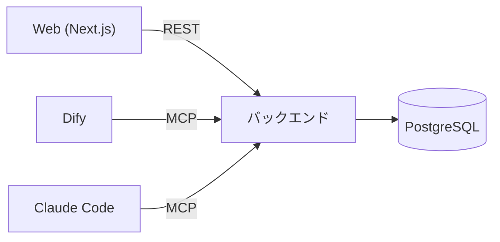

# 開発環境要件

Webアプリケーションから利用するバックエンドを開発するための、本番環境の構成とローカル開発環境の要件を定義する。

## AIへの指示

- 本書に従ってローカル開発環境を構築・保守する。
- 認証情報とデータベース名は `.env` にのみ記載し、本書・compose ファイル・ソースコード・ドキュメントには値を書かない (ENV-019)。
- 本書に記載のないライブラリ・サービスを利用する場合は、実装前にユーザーへ確認する。確認して承認されたものは「[承認済みの追加ライブラリ・サービス](#承認済みの追加ライブラリサービス)」に追記する。
- 要件は ID (`ENV-xxx`) で参照できる。変更時は該当 ID の記述を更新する。
- 手順書は [backend/README.md](../../backend/README.md) にまとめる。リポジトリ直下の `README.md` は変更しない。

## 1. システム構成

### 1.1 本番環境

| 項目 | 内容 |
|---|---|
| Webアプリケーション | Next.js |
| データベース | Amazon RDS for PostgreSQL |
| バックエンド | FastAPI (REST API) と FastMCP (MCP サーバー) |
| 利用者 | Webアプリケーション、Dify、Claude Code |



### 1.2 機能要件

| ID | 要件 |
|---|---|
| ENV-001 | Webアプリケーションは Next.js で構築する。 |
| ENV-002 | バックエンドのデータは Amazon RDS for PostgreSQL に保持する。 |
| ENV-003 | データ取得API: Webアプリケーションが呼び出すと、バックエンドが PostgreSQL のデータを JSON 形式に変換して応答する。 |
| ENV-004 | データ設定API: Webアプリケーションが設定対象の JSON を指定して呼び出すと、バックエンドが DB のレコード形式に変換して PostgreSQL を更新する。 |
| ENV-005 | Dify や Github Copilot / Claude Code が MCP でバックエンドに接続し、バックエンドが提供するAPIを利用できる。 |
| ENV-006 | データベースは、本番 (Amazon RDS for PostgreSQL) とローカルのどちらも PostgreSQL 18 を使用する。 |

## 2. ローカル開発環境の要件

ENV-001〜006 の構成を、AWS を使わずにローカルで再現する。

| ID | 要件 |
|---|---|
| ENV-010 | VS Code と GitHub Copilot を使い、WSL と macOS で構築できる。 |
| ENV-011 | チームの複数人が同じ環境を共有できるよう、Dev Containers と Docker Compose を使用する。 |
| ENV-013 | ローカルの PostgreSQL の初期データは、JSON 形式のファイルで定義できる。 |
| ENV-014 | データベースの内容を簡単に確認できる。 |
| ENV-015 | データベースの内容を、初期投入データとして使える JSON 形式でエクスポートできる。 |
| ENV-016 | リポジトリのルートで `docker compose up` を実行すると、フロントエンド、バックエンド、データベース、各種ツールがすべて起動し、初期データが投入される。 |
| ENV-017 | Compose ファイルはサービスの種類ごとに分割する。Dify など他のサービスを、後から別ファイルとして追加できる。 |
| ENV-018 | 初期のテーブルは [design/database/er-design.md](../database/er-design.md) に従い、Alembic のマイグレーションで作成する。 |
| ENV-019 | 認証情報 (DB のユーザー名・パスワード) とデータベース名は、環境変数ファイル `.env` のみで管理する。`.env` は Git にコミットせず、雛形の `.env.example` をコミットする。compose ファイル、ソースコード、ドキュメントにはこれらの値を書かず、環境変数 (`POSTGRES_USER` / `POSTGRES_PASSWORD` / `POSTGRES_DB`) として参照する。 |
| ENV-020 | `.env` の環境変数を VS Code のターミナルで有効にするため、`.vscode/settings.json` に `"python.terminal.useEnvFile": true` を設定する。 |

## 3. 技術スタック

### 3.1 バックエンド

| パッケージ | 用途 | ライセンス | 商用利用 | ソース公開義務 | 備考 |
|---|---|---|---|---|---|
| FastAPI | Webフレームワーク | MIT | 可能（無償） | なし | 改変・商用配布・閉域利用すべて自由 |
| Pydantic v2 (pydantic / pydantic-core) | JSON検証・変換 | MIT | 可能（無償） | なし | 開発元の監視SaaS「Pydantic Logfire」を使う場合のみ別料金。ライブラリ自体は完全無償の MIT |
| SQLAlchemy | ORM・DB操作 | MIT | 可能（無償） | なし | バージョン 1.4 / 2.0 ともに MIT ライセンス |
| SQLModel | 統合ORM | MIT | 可能（無償） | なし | FastAPI と同じ作者による MIT ライセンス |
| Alembic | DBマイグレーション | MIT | 可能（無償） | なし | SQLAlchemy 作者による標準マイグレーションツール |
| Uvicorn | ASGI Webサーバー | BSD-3-Clause | 可能（無償） | なし | MIT と同等の寛容なライセンス |
| FastMCP / MCP SDK | MCPサーバー構築 | Apache-2.0 / MIT | 可能（無償） | なし | 公式 mcp SDK は MIT、FastMCP は Apache-2.0 |

### 3.2 承認済みの追加ライブラリ・サービス

3.1 に記載のないもので、ユーザーが利用を承認したもの。

| 名称 | 用途 | ライセンス | 備考 |
|---|---|---|---|
| Adminer | DB の内容確認 (Web GUI) | Apache-2.0 / GPL-2.0 | ENV-014 を満たす。Compose のサービスとして起動する |
| psycopg 3 | PostgreSQL ドライバ | LGPL-3.0 | 動的リンクで利用する |
| jsonschema (4.x) | JSON Schema (draft 2020-12) の検証 | MIT | ENV-022・ENV-023 を満たす。バックエンドの依存に追加する。メタスキーマ検証 (`Draft202012Validator.check_schema`) にも使う |
| pytest | テスト | MIT | 開発用依存 |
| ruff | Lint・フォーマット | MIT | 開発用依存 |

3.1・3.2 以外に、次を構成上の前提として使用している (Dev Container・Next.js の標準構成)。

- Node.js 22 (Next.js の実行環境)
- Next.js (App Router / TypeScript。Tailwind CSS と Google Fonts は使用しない)

## 4. データベース

| 項目 | 内容 |
|---|---|
| 製品・バージョン | PostgreSQL 18 (本番・ローカルとも。ENV-006) |
| データベース名 | `.env` の `POSTGRES_DB` で設定する。本書には値を記載しない (ENV-019)。PostgreSQL では大文字小文字を区別する |
| 保存するデータ | 開発データ。認証情報はデータベースに保存しない |
| 接続情報の定義場所 | リポジトリ直下の `.env` (`POSTGRES_USER` / `POSTGRES_PASSWORD` / `POSTGRES_DB`)。雛形は [.env.example](../../.env.example) |
| スキーマ定義 | [design/database/er-design.md](../database/er-design.md) |
| マイグレーション | Alembic (`backend/alembic/versions/`)。DB を直接変更せず、モデル ([backend/app/models.py](../../backend/app/models.py)) の編集とマイグレーションで変更する |

### 4.1 初期データ (ENV-013, ENV-015)

| 項目 | 内容 |
|---|---|
| 配置 | `backend/seed/*.json` |
| 形式 | `{"テーブル名": [{"列名": 値, ...}, ...]}` |
| ファイル構成 | `00_sample_master.json` (ER 設計に基づくサンプル。手書き。ENV-027)、`10_json_schema.json` (JSON スキーマ。生成。ENV-025)、`20_artifact_examples.json` (成果物の例。生成。ENV-026)。生成ファイルは手で編集せず、[4.4 の生成ツール](#44-初期データの生成ツール-env-025env-028) で再生成する |
| 投入 | `python -m app.cli seed`。ファイル名順に読み込み、外部キー順に挿入する。主キーが重複する行はスキップする。投入元のディレクトリ (既定は `backend/seed/`) は、`backend/` からの相対位置で決める。`backend` コンテナは `backend/` だけを `/app` にマウントするため、リポジトリルートからの相対位置で決めてはならない (`/app/seed` を参照できなくなり、何も投入されない)。同じテーブル内で指定する列が行ごとに異なっていてもよい (省略した列は DB のデフォルト値になる) |
| エクスポート | `python -m app.cli export [-o 出力先]`。出力はそのまま投入データとして使える |

### 4.2 DB の内容確認 (ENV-014)

- Adminer (`http://localhost:8080`) をブラウザで開く。サーバー `db` に接続済みの状態で、`.env` の接続情報を入力してログインする。
- ターミナルから `psql` で確認することもできる。

### 4.3 JSON スキーマによる jsonb 列の定義と検証 (ENV-021〜ENV-024)

ユーザーが JSON スキーマを動的に変更できるよう、jsonb 列の構造はアプリケーションコードやマイグレーションに固定せず、`JSON_SCHEMA` テーブルのデータとして定義する。

| ID | 要件 |
|---|---|
| ENV-021 | `JSON_SCHEMA` テーブル以外のテーブルに含まれる jsonb 列 (現状は `CONTENT_REVISION.content_json`) の構造は、`JSON_SCHEMA.schema_json` に格納した JSON Schema で定義する。jsonb 列の構造をモデル ([backend/app/models.py](../../backend/app/models.py)) やマイグレーションで定義しない。jsonb 列を持つテーブルは、適用する `JSON_SCHEMA` の行を `schema_id` で参照する。 |
| ENV-022 | レコードの追加・更新時 (REST API・MCP ツールの両方) に、バックエンドが jsonb 列の値を対応する `JSON_SCHEMA.schema_json` で検証する。検証を通過した場合にのみデータベースを更新し、通過しなかった場合は何も書き込まない。検証は REST と MCP で共通の処理 (`services.py`) として実装し、DB への書き込みと同一トランザクションで行う。 |
| ENV-023 | JSON スキーマの検証でエラーが発生した場合、バックエンドは更新を拒否し、エラーの詳細を要求元に応答する。応答には、使用したスキーマの識別情報 (`schema_id`、`schema_key`、`schema_version`) と、違反ごとの詳細 (違反箇所の JSON Pointer、違反した制約、メッセージ) をすべて含める。あわせて、スキーマを再取得する手段 (API・MCP ツール) を示す。これにより、呼び出し元 (AI または人間) が最新のスキーマを再取得し、入力を自己修正して再送できる。 |
| ENV-024 | JSON スキーマの編集手順を [backend/README.md](../../backend/README.md) に記載する。 |

JSON スキーマの扱いは次のとおりとする。

- JSON スキーマの仕様は draft 2020-12 とする ([design/database/json-schema-design.md](../database/json-schema-design.md))。
- 登録済みの `JSON_SCHEMA` 行は更新・削除できない (整合性ルール8)。スキーマの変更は、同じ `schema_key` で `schema_version` を増やした新しい行の追加として行う。既存のリビジョンは作成時点の `schema_id` を参照し続ける。
- スキーマの追加・変更はデータの投入 (`backend/seed/*.json` またはAPI) で行い、Alembic のマイグレーションや再デプロイを要さない。設計ファイル (`design/database/schemas/`) を編集した場合は、[生成ツール](#44-初期データの生成ツール-env-025env-028) で `backend/seed/` に反映する。
- `JSON_SCHEMA` へ登録する `schema_json` 自体も、登録前に JSON Schema のメタスキーマで検証する。不正なスキーマは登録しない。
- 検証エラーの応答は REST では HTTP 422 とし、MCP ではツールのエラーとして、同じ内容を構造化データで返す。

エラー応答の例:

```json
{
  "error": "json_schema_validation_failed",
  "schema": { "schema_id": "...", "schema_key": "sys.artifact", "schema_version": 1 },
  "errors": [
    {
      "path": "/artifact_type",
      "schema_path": "/properties/artifact_type/enum",
      "validator": "enum",
      "message": "'UNKNOWN' is not one of ['sys2.use_case', '...']"
    }
  ],
  "hint": "スキーマを再取得し、errors の path を修正して再送してください"
}
```

### 4.4 初期データの生成ツール (ENV-025〜ENV-028)

JSON スキーマの設計 (`design/database/` 配下) を変更したとき、その内容を初期投入データへ反映できるよう、設計ファイルを初期投入データへ変換するツールを用意する。

| ID | 要件 |
|---|---|
| ENV-025 | 生成ツールを実行すると、[design/database/json-schema-design.md](../database/json-schema-design.md) に定義された JSON スキーマ (「配置と生成」の `schemas/sys.artifact.schema.json`) を `JSON_SCHEMA` テーブルの初期投入データに変換し、`backend/seed/10_json_schema.json` に格納する。 |
| ENV-026 | 生成ツールを実行すると、`design/database/schemas/examples/*.json` の正常例 (`valid`) を、データベースの初期投入データ (`CONTENT_RECORD` / `CONTENT_REVISION`) に変換し、`backend/seed/20_artifact_examples.json` に格納する。 |
| ENV-027 | [design/database/er-design.md](../database/er-design.md) の全テーブル (12 テーブル) について、各テーブル 1 レコード以上の初期投入データを作成し、`backend/seed/` に格納する (`00_sample_master.json`)。 |
| ENV-028 | 生成ツールの使い方を [backend/README.md](../../backend/README.md) の「初期投入データの編集手順」に記載する。 |

#### ツール仕様 (ENV-025・ENV-026)

| 項目 | 内容 |
|---|---|
| 実行 | `backend/` ディレクトリへ移動して `python -m app.cli build-seed` を実行する (`cd backend && python -m app.cli build-seed`)。`app` パッケージは `backend/` 直下にあり、リポジトリ直下では `No module named 'app'` で失敗するため。リポジトリ直下から実行する場合は `PYTHONPATH=backend python -m app.cli build-seed` とする。`--check` を付けると、ファイルを書き込まず、`backend/seed/` の生成ファイルが設計ファイルと一致するかだけを確認する (一致しなければ終了コード 1)。DB への接続は不要。実行には `backend/pyproject.toml` の依存 (`jsonschema` など) が必要 |
| 実行場所 | ホストまたは Dev Container の `app` コンテナ。`backend` コンテナは `backend/` だけをマウントし `design/` を参照できないため、コンテナ内では実行しない。`docker compose up` では実行されない。生成したファイルをコミットする。生成ファイルを読む `seed` は `design/` を必要としないため、コンテナで動作する (出力先の `backend/seed/` は `backend/` からの相対位置で決めるため、コンテナ内でも同じファイルを指す) |
| 入力 | `design/database/schemas/sys.artifact.schema.json` と `design/database/schemas/examples/*.json` |
| 出力 | `backend/seed/10_json_schema.json`、`backend/seed/20_artifact_examples.json` (形式は 4.1 のとおり) |

ENV-025 (`JSON_SCHEMA`) の変換規則:

- 入力のスキーマを Draft 2020-12 のメタスキーマで検証し、通過しなければ出力せずエラー終了する (ENV-021 の「不正なスキーマは登録しない」と同じ)。
- `schema_json` にはスキーマ全体をそのまま格納する。`schema_key` と `schema_version` は `$id` (`urn:das:schema:<schema_key>:<schema_version>`) から取り、`record_type` = `ARTIFACT`、`feature_domain` = NULL とする (json-schema-design.md の「方針」)。
- `schema_id` は `$id` から決定的に生成する (UUIDv5、名前空間 `NAMESPACE_URL`、名前は `$id` の値)。再生成しても同じ値になり、手書きのサンプル (ENV-027) からも同じ規則で参照できる。
- 登録済みスキーマは更新できない (整合性ルール8) ため、出力ファイルに既にある別の版 (`schema_key` が同じで `schema_version` が異なる行) は残し、新しい版の行を追加する。同じ `schema_key`・`schema_version` で `schema_json` が異なる場合は、版を上げるよう促してエラー終了する。

ENV-026 (成果物の例) の変換規則:

- 各ファイルの `valid` の要素 1 件を、`CONTENT_RECORD` 1 行と `CONTENT_REVISION` 1 行 (`revision_no` = 1、`content_json` = 要素そのまま、`schema_id` = ENV-025 で生成した行、`change_reason` = 例からの初期投入であることを示す文言) に変換する。`invalid` は変換しない。
- 変換前に、すべての `valid` を入力のスキーマで検証する。通過しない要素があれば、出力せずエラー終了する (`validate.py` と同じ判定)。
- `CONTENT_RECORD` は `record_type` = `ARTIFACT`、`feature_domain` = NULL、作成元なし (`origin_platform_id`・`origin_product_id` は NULL の共通レコード) とする。`logical_key` は `<ファイル名の種別キー>.<ファイル内の連番 (001 から)>` (例: `sys1.actor.001`) とする。
- `record_id` と `revision_id` は `logical_key` から決定的に生成する (UUIDv5、名前空間 `NAMESPACE_URL`、名前はそれぞれ `urn:das:seed:record:<logical_key>`、`urn:das:seed:revision:<logical_key>:1`)。
- 例の中の `RecordRef` (`record_id`) は書き換えない。参照先の存在確認は書き込み時に MCP サーバーが行う検証であり、初期投入では行わない。
- 出力は、キーの並び・配列の順序を固定し、同じ入力から常に同じ内容になるようにする (差分を最小にし、`--check` を成立させるため)。

#### テスト

- 生成ファイルが設計ファイルと一致すること (`--check` 相当)、再生成しても同じ内容になること、不正なスキーマ・例を拒否すること、サンプルが全 12 テーブルを含みスキーマで検証を通ること、を `backend/tests/test_seed_builder.py` で確認する。
- 初期データの既定の出力先・投入元が `backend/` からの相対位置であること (コンテナの `/app` でも `seed` が見つかること) を確認する。
- `design/` を読むテストは、`design/` が存在しない環境 (`backend` コンテナ) ではスキップする。`design/` を読む既存のテストは、ホストまたは Dev Container で実行する。
- 登録済みの `json_schema` の行と重複しないよう、スキーマ登録を試すテストは、初期データ (`sys.artifact` 版 1) と異なる `schema_key` を使う。

#### サンプルデータ (ENV-027)

- ER 設計のテーブル `CUSTOMER` / `PRODUCT` / `PLATFORM` / `PLATFORM_VERSION` / `PRODUCT_VERSION` / `CONTENT_RECORD` / `CONTENT_REVISION` / `REVISION_PARENT` / `JSON_SCHEMA` / `PLATFORM_SCHEMA_BINDING` / `PLATFORM_VERSION_CONTENT` / `PRODUCT_VERSION_CONTENT` を対象とする。`JSON_SCHEMA` の行は ENV-025 の出力が担うため、`00_sample_master.json` には含めず、`PLATFORM_SCHEMA_BINDING` などから ENV-025 と同じ規則で `schema_id` を参照する。
- 各行は、外部キー・CHECK 制約・整合性ルール (er-design.md) を満たす。`CONTENT_REVISION` の `content_json` は `sys.artifact` スキーマで検証して通過する内容とする。
- 現行の `sys.artifact` は `ARTIFACT` 用のため、サンプルのレコードは `record_type` = `ARTIFACT` とする。`FEATURE` 用のスキーマを追加した際は、あわせてサンプルを追加する。
- `REVISION_PARENT` は、同一レコードの 2 つのリビジョンを `PREVIOUS` で結ぶ行とする。
- 製品の `base_platform_version_id` は、サンプルのプラットフォームバージョンを参照する。
- 主キーは、他ファイルの行から参照できるよう、固定値で書く。他の行と重複しない値とし、ENV-026 の生成値とは重ならないようにする。
- 認証情報・データベース名を含めない (ENV-019)。

## 5. Docker Compose 構成

### 5.1 ファイル構成 (ENV-016, ENV-017, ENV-019, ENV-020)

```text
.env                    # 認証情報・データベース名 (Git にコミットしない)
.env.example            # .env の雛形 (コミットする)
.vscode/
  settings.json         # VS Code のワークスペース設定 ("python.terminal.useEnvFile": true)
compose.yaml            # 起点。compose/ 配下のファイルを include で読み込む
compose/
  db.yaml               # PostgreSQL
  backend.yaml          # backend-init (マイグレーション + 初期データ投入)、backend
  web.yaml              # Next.js
  tools.yaml            # Adminer
  dify.yaml             # (追加予定) Dify
.devcontainer/
  devcontainer.json
  docker-compose.yml    # Dev Container 用 (db・adminer は compose/ を共有)
  Dockerfile
  post-create.sh
```

- 新しいサービスは `compose/<名前>.yaml` として追加し、`compose.yaml` の `include` に 1 行加える。
- 追加するファイルは、既存のサービス名・ボリューム名と重複させない。ポートは `127.0.0.1:${XXX_PORT:-既定値}:内部ポート` の形式にそろえる。
- 秘密の値は `.env` に変数を追加し、`env_file: [../.env]` で読み込む。`.env.example` にも変数名と仮の値を追記する。
- `.env` がない場合、Dev Container は `.env.example` から自動作成する。ルートの `docker compose` は `.env` がないと失敗するため、`cp .env.example .env` が必要。

### 5.2 サービス

| サービス | 内容 | 公開ポート (ホスト側) | 変更用の環境変数 |
|---|---|---|---|
| `db` | PostgreSQL 18 | 5432 | `DB_PORT` |
| `backend-init` | マイグレーション適用と初期データ投入。完了すると終了する | なし | なし |
| `backend` | REST API (`/`)、MCP (`/mcp/`)。ヘルスチェック: `/health` | 8000 | `BACKEND_PORT` |
| `web` | Next.js 開発サーバー | 3000 | `WEB_PORT` |
| `adminer` | DB 確認用 GUI | 8080 | `ADMINER_PORT` |

起動順序: `db` (healthy) → `backend-init` (正常終了) → `backend` (healthy) → `web` (healthy)

`web` は初回に `npm install` を実行し、完了時に `node_modules/.installed-<package-lock.json のハッシュ>` を作成する。このファイルがなければ `node_modules` を空にして入れ直す (インストール中断による破損対策)。ヘルスチェックで起動完了を待てる (`docker compose up -d --wait`)。

### 5.3 Dev Container (ENV-010, ENV-011)

- 起動方法: VS Code の「Dev Containers: Reopen in Container」。
- 構成: `app` (開発コンテナ。Python 3.13、Node.js 22、psql)、`db`、`adminer`。`backend` と `web` は自動起動せず、`app` 内で手動起動する。
- 初回作成時に `post-create.sh` が、依存パッケージのインストール、`alembic upgrade head`、初期データ投入、`npm install` を実行する。
- ルートの `docker compose up` とは同時に使わない (同じプロジェクト・同じ DB ボリュームを共有する)。

### 5.4 VS Code の設定 (ENV-020)

`.env` の環境変数を VS Code のターミナルで有効にするため、`.vscode/settings.json` に次を設定する。

```json
{
  "python.terminal.useEnvFile": true
}
```

- 設定場所: リポジトリ直下の `.vscode/settings.json` (ワークスペース設定)。チームで共有するためコミットする。
- 効果: VS Code の統合ターミナルに、`.env` (既定のパス: `${workspaceFolder}/.env`) の変数が読み込まれる。`.env` の値は設定ファイルに書かない (ENV-019)。
- 反映: 設定を変更・追加した後は、ターミナルを開き直す。`.env` を編集した場合も同様。
- Dev Container では、`app` コンテナが `env_file` で `.env` を読み込むため、この設定がなくてもコンテナ内の変数は有効になる。Dev Container を使わずに、WSL や macOS 上のターミナルから `backend` などを直接実行する場合に必要となる。

## 6. セキュリティ・運用ルール

- 開発コンテナ (`app`、`backend`、`web`) は全 capability を削除し、`no-new-privileges` を設定し、非 root で実行する。sudo は導入しない。
- Dev Container 内の `.git` は読み取り専用でマウントする。`git commit` / `git push` はホスト側で実行する。
- 公開ポートは `127.0.0.1` のみに限定する。
- ローカルの DB 接続情報は開発専用の値に限り、本番 (Amazon RDS) の認証情報には使用しない。
- 認証情報とデータベース名は `.env` にのみ記載する (ENV-019)。本書、compose ファイル、ソースコード、データベースの内容 (初期データ JSON を含む) には含めない。`.env` はコミットしない。

## 7. 成果物と手順書

手順書は [backend/README.md](../../backend/README.md) に次の内容をまとめる。

| 章 | 内容 |
|---|---|
| 1 | 環境構築手順 (Dev Container、ルートの `docker compose up`、Compose ファイルの追加方法) |
| 2 | GitHub Copilot での MCP 設定手順 |
| 3 | REST API / MCP ツールの構築手順 |
| 5 | 初期投入データの編集手順 (生成ツールの使い方を含む。ENV-028) |
| 4 | DB の内容確認・編集手順 |
| 6 | スキーマ変更手順 |
| 7 | JSON スキーマの編集手順 (ENV-024) |
