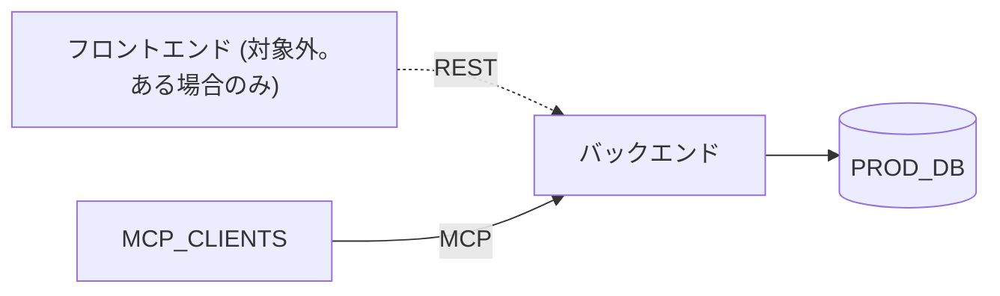
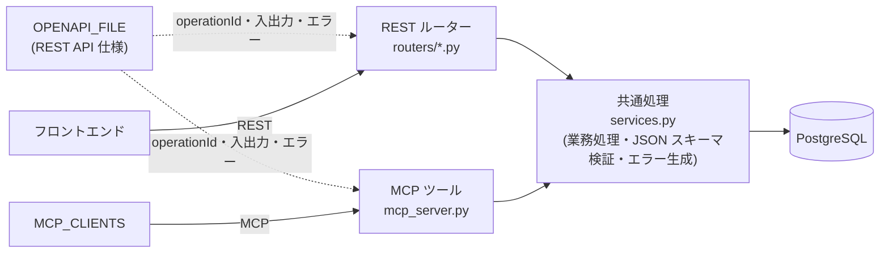

# 開発環境要件 (バックエンド)

バックエンドを開発するための、本番環境の構成とローカル開発環境の要件を定義する。対象はバックエンドのみとする。フロントエンドは対象外であり、環境にすでにある場合は共存させる。フロントエンドの Compose サービス定義だけは `COMPOSE_DIR/web.yaml` に集約し、バックエンドとの連携設定を含める (ENV-030・ENV-031・ENV-039)。

## 0. 設定項目

別の開発環境 (リポジトリ) へ反映するときは、**次の「設定項目」の表の値だけを書き換える**。本書の他の章と AI の作業は、ここで定義したキー名で値を参照する。表の値は本リポジトリでの設定である。

### 0.1 設定項目 (変更できる)

| キー | 本リポジトリの値 | 内容 |
|---|---|---|
| `ER_DESIGN_FILE` | `design/database/er-design.md` | データベースのスキーマ (テーブル・列・制約・整合性ルール) を記載した Markdown ファイル。テーブル定義と初期データ生成の正本。1 ファイルのみ指定する |
| `JSON_SCHEMA_DESIGN_DIR` | `design/database` | JSON スキーマの設計を記載した Markdown ファイルを置くディレクトリ。**このディレクトリ以下のすべての `.md` ファイルを対象とする** (対象の決め方は [0.3](#03-json-スキーマ設計ファイルの対象))。JSON スキーマの格納場所、対応するレコード・列は、各ファイルの記載に従う (ENV-034・ENV-035) |
| `API_GUIDELINE_FILE` | `design/requiments/api-guideline.md` | REST API の作成規約 (命名、ステータス、エラー形式、認証、バージョニングなど) を記載した Markdown ファイル。REST API の作成・変更は、このファイルに従う (ENV-041)。1 ファイルのみ指定する |
| `COMPOSE_ENTRY` | `compose.yaml` | Docker Compose の起点ファイル |
| `COMPOSE_DIR` | `compose` | サービスの種類ごとに分割した Compose ファイルの配置先 |
| `COMPOSE_PROJECT` | `inteligent_database` | Compose のプロジェクト名 (既存環境と重ならない名前にする) |
| `BACKEND_IMAGE` | `idb-backend:dev` | バックエンドのイメージ名 |
| `DB_PORT` / `BACKEND_PORT` | 5432 / 8000 | ホスト側の公開ポートの既定値 |

### 0.2 固定値 (変更しない)

次の値は固定であり、設定項目としない。別のリポジトリでも同じ値で構築する。

| キー | 固定値 | 内容 |
|---|---|---|
| `BACKEND_DIR` | `backend` | バックエンドのソース、マイグレーション、初期データを置くディレクトリ |
| `SEED_DIR` | `backend/seed` | 初期投入データ (JSON) の配置先 |
| `README_FILE` | `backend/README.md` | 手順書。リポジトリ直下の `README.md` は変更しない |
| `DB_ENGINE` | PostgreSQL 18 | データベース。本番・ローカルとも同じバージョンを使う (ENV-006) |
| `PROD_DB` | Amazon RDS for PostgreSQL | 本番のデータベース |
| `BACKEND_STACK` | FastAPI (REST API) と FastMCP (MCP サーバー) | バックエンドの実装方式。ライブラリは [3.1](#31-バックエンド) |
| `MCP_CLIENTS` | Dify、GitHub Copilot、Claude Code | MCP でバックエンドに接続する利用者 |
| `OPENAPI_DIR` | `openapi` | OpenAPI 仕様を置くディレクトリ |
| `OPENAPI_FILE` | `openapi/openapi.yaml` | OpenAPI 3.1 の仕様。直接編集する。JSON スキーマテーブルのスキーマは外部参照 (URL。ホストと版は書かない) で記載する (ENV-043・ENV-047)。バックエンドが配信し、`/docs` で表示する (ENV-048)。REST API の実装はこの仕様に基づく |

- Python は 3.13 以上を使う。バージョンは設定項目ではない。開発環境に入っている Python が 3.13 未満の場合は、AI が対応方法 (Python のインストール・更新、コンテナ内の Python を使うなど) をユーザーに確認してから進める (ENV-038)。

### 0.3 JSON スキーマ設計ファイルの対象

`JSON_SCHEMA_DESIGN_DIR` には、リポジトリのルートからの相対パスで**ディレクトリを 1 つ**指定する。ファイルを 1 つずつ列挙しない。

- 対象は、指定したディレクトリ以下 (サブディレクトリを含む) にある**すべての `.md` ファイル**とする。Markdown ファイルをディレクトリに追加すれば、設定を変えずに対象へ加わる。
- パスの昇順に処理する。
- `ER_DESIGN_FILE` が同じディレクトリ以下にある場合は、対象から除外する。
- JSON スキーマの設計が書かれていない Markdown (README など) は、対象から除外する。除外したファイルは、作業の報告に一覧で示す。JSON スキーマの設計かどうかを判断できないファイルは、ユーザーに確認する。
- ディレクトリが存在しない場合、または対象の Markdown が 1 つもない場合は、ユーザーに確認する。
- 各ファイルに、スキーマの格納場所と、対応するレコード・列が記載されている必要がある (ENV-035)。

### 0.4 設定項目に関する共通ルール

- 認証情報 (DB のユーザー名・パスワード) とデータベース名は、設定項目に書かず `.env` にのみ記載する (ENV-019)。
- 上記以外の項目 (サービス名、ファイル名、テーブル名など) は、設定項目から導出するか、`ER_DESIGN_FILE` / `JSON_SCHEMA_DESIGN_DIR` の記載から取る。本書に例として書かれたテーブル名・ファイル名 (`JSON_SCHEMA`、`CONTENT_REVISION` など) は本リポジトリの設計に基づく例であり、別のリポジトリでは各 Markdown ファイルの記載に読み替える。

## AIへの指示

- 本書に従ってローカル開発環境を構築・保守する。まず [0. 設定項目](#0-設定項目) を読み、各キーの値を確定してから作業する。
- REST API は `API_GUIDELINE_FILE` に従って作成する (ENV-041)。JSON スキーマテーブルのスキーマを取得できる REST API を用意する (ENV-042)。
- 次の場合は、実装前にユーザーへ確認する (質問は `ask_user` など対話の手段で行い、推測で進めない)。
  - `JSON_SCHEMA_DESIGN_DIR` 以下の Markdown から、JSON スキーマが対応するレコードや列を特定できない場合 (ENV-035)。
  - 設定項目の値が、対象リポジトリの既存の環境 (ディレクトリ、サービス名、ボリューム名、ポート、Compose プロジェクト名、Dev Container など) と衝突する場合。
  - 設定項目に定めた名称・ポートを、既存環境の都合で変更する必要がある場合。
  - 開発環境に入っている Python が 3.13 未満の場合 (ENV-038)。
  - `API_GUIDELINE_FILE` が存在しない場合、またはその記載が他の要件と矛盾する場合。
  - 本書に記載のないライブラリ・サービスを利用する場合。承認されたものは「[承認済みの追加ライブラリ・サービス](#32-承認済みの追加ライブラリサービス)」に追記する。
- 認証情報とデータベース名は `.env` にのみ記載し、本書・compose ファイル・ソースコード・ドキュメントには値を書かない (ENV-019)。
- 要件は ID (`ENV-xxx`) で参照できる。変更時は該当 ID の記述を更新する。
- 手順書は `README_FILE` にまとめる。
- 実装後は、[4.5 構築後の確認](#45-構築後の確認-env-037) まで実施し、結果をユーザーに報告する。確認できていない項目がある場合は完了としない。

## 1. システム構成

### 1.1 本番環境

| 項目 | 内容 |
|---|---|
| データベース | `PROD_DB` |
| バックエンド | `BACKEND_STACK` |
| 利用者 | フロントエンド (REST。ある場合のみ)、`MCP_CLIENTS` (MCP) |



### 1.2 機能要件

| ID | 要件 |
|---|---|
| ENV-002 | バックエンドのデータは `PROD_DB` に保持する。 |
| ENV-003 | データ取得API: 呼び出し元が呼び出すと、バックエンドがデータベースのデータを JSON 形式に変換して応答する。 |
| ENV-004 | データ設定API: 呼び出し元が設定対象の JSON を指定して呼び出すと、バックエンドが DB のレコード形式に変換してデータベースを更新する。 |
| ENV-005 | `MCP_CLIENTS` が MCP でバックエンドに接続し、バックエンドが提供するAPIを利用できる。 |
| ENV-006 | データベースは、本番 (`PROD_DB`) とローカルのどちらも `DB_ENGINE` を使用する。 |

### 1.3 対象範囲 (ENV-030, ENV-031)

| ID | 要件 |
|---|---|
| ENV-030 | 本書が構築・保守する対象は、バックエンド・データベース・その開発環境と、フロントエンドの Compose サービス定義 (`COMPOSE_DIR/web.yaml`。ENV-039) のみとする。フロントエンド (Web アプリケーション) 自体のソースや、フロントエンドの実行環境 (Node.js など) の構築・変更は含めない。 |
| ENV-031 | 環境にすでにフロントエンドの環境 (Compose のサービス、Dev Container、パッケージ管理ファイルなど) がある場合は、フロントエンドの動作を変えず、バックエンドの環境を共存する形で構築する。共存のルールは次のとおり。 |
| ENV-039 | フロントエンドの Compose サービスは `COMPOSE_DIR/web.yaml` に定義する。環境に既存の `COMPOSE_ENTRY` がある場合は、その内容を `web.yaml` に反映する。既存の `COMPOSE_ENTRY` にない場合でも、バックエンドとの連携に必要な設定を `web.yaml` に追加する。詳細は [1.3.1](#131-webyaml-への反映-env-039)。 |

ENV-031 の共存のルール:

- Dev Container の設定など `COMPOSE_ENTRY` 以外の既存ファイルは、バックエンドに必要な部分だけを追加する。上書き・再生成しない。
- バックエンドのサービスは `COMPOSE_DIR` 配下の別ファイル (`db.yaml`、`backend.yaml`) として追加し、`COMPOSE_ENTRY` の `include` に加える。
- サービス名・ボリューム名・ポート・ネットワーク・Compose プロジェクト名は、既存のものと重複させない。重複する場合はユーザーに確認する。
- バックエンドのサービス名とポートを変えた場合は、フロントエンドの接続先 (`web.yaml` の環境変数など) も合わせて変える。
- 既存の Dev Container がある場合は、バックエンドの開発に必要なもの (Python 3.13 以上、psql) を追加する。フロントエンドの実行環境 (Node.js など) は残す。
- フロントエンドの環境がない場合は、バックエンドのみで完結する構成にする (`web.yaml` を含め、フロントエンドのサービスと実行環境は作らない)。

#### 1.3.1 web.yaml への反映 (ENV-039)

**既存の `COMPOSE_ENTRY` がある場合**

- 既存の `COMPOSE_ENTRY` に定義された内容 (サービス、ボリューム、ネットワークなどのフロントエンドに関するもの) を、`COMPOSE_DIR/web.yaml` へ反映する。設定の意味を変えない (ビルド、コマンド、環境変数、ポート、ボリューム、ヘルスチェックなどをそのまま移す)。
- `web.yaml` は `COMPOSE_DIR` 配下に置くため、相対パス (`build.context`、`volumes`、`env_file` など) は `COMPOSE_DIR` からの位置に書き換える (例: `./web` → `../web`)。
- 反映後、`COMPOSE_ENTRY` は起点ファイル (`name` と `include` のみ。`COMPOSE_PROJECT` を `name` に指定) に書き換え、`include` に `db.yaml`、`backend.yaml`、`web.yaml` を並べる。元の内容は `web.yaml` に移っているため、`COMPOSE_ENTRY` に重複して残さない。
- 既存の `COMPOSE_ENTRY` にフロントエンド以外のサービス (別の DB、キャッシュなど) が含まれる場合は、反映先 (`web.yaml` か別ファイルか) と、バックエンドの `db` との重複の扱いをユーザーに確認する。

**バックエンドとの連携に必要な設定 (既存の `COMPOSE_ENTRY` の有無にかかわらず、`web.yaml` に含める)**

| 設定 | 内容 |
|---|---|
| バックエンドの接続先 | 環境変数でバックエンドの URL (Compose ネットワーク内: `http://backend:8000`) を渡す。既存のフロントエンドに同様の環境変数 (例: `BACKEND_URL`) があればその名前を使い、なければ `BACKEND_URL` とする |
| 起動順序 | `depends_on` で `backend` の `service_healthy` を待つ。バックエンドのヘルスチェックは `/health` |
| ネットワーク | `backend` と同じ Compose ネットワークに参加させる (既存のフロントエンドが独自のネットワークを持つ場合は、既定のネットワークにも参加させる) |
| ポート | `127.0.0.1:${WEB_PORT:-<既存のポート>}:<内部ポート>` の形式にそろえる。バックエンドのポート (`BACKEND_PORT`) と重ならない値にする |
| 起動完了の待機 | `docker compose up --wait` で待てるよう、フロントエンドにヘルスチェックを設定する (既存の設定があればそれを残す) |

- 認証情報・データベース名を `web.yaml` に書かない (ENV-019)。フロントエンドが秘密の値を必要とする場合は、`.env` に変数を追加し `env_file` で読み込む。
- フロントエンドのコンテナからは DB に直接接続させない。バックエンド (REST) を経由する。

## 2. ローカル開発環境の要件

ENV-002〜006 の構成を、AWS を使わずにローカルで再現する。

| ID | 要件 |
|---|---|
| ENV-010 | VS Code と GitHub Copilot を使い、WSL と macOS で構築できる。 |
| ENV-011 | チームの複数人が同じ環境を共有できるよう、Dev Containers と Docker Compose を使用する。 |
| ENV-013 | ローカルの PostgreSQL の初期データは、JSON 形式のファイルで定義できる。 |
| ENV-014 | データベースの内容を、VS Code の PostgreSQL 拡張機能で簡単に確認できる。Adminer など、確認専用のサービスは Compose に含めない。 |
| ENV-015 | データベースの内容を、初期投入データとして使える JSON 形式でエクスポートできる。 |
| ENV-016 | リポジトリのルートで `docker compose up` を実行すると、バックエンドとデータベースがすべて起動し、初期データが投入される。既存のフロントエンドのサービスがある場合は、それも従来どおり起動する (ENV-031)。 |
| ENV-017 | Compose ファイルはサービスの種類ごとに分割する。Dify など他のサービスを、後から別ファイルとして追加できる。 |
| ENV-018 | 初期のテーブルは `ER_DESIGN_FILE` に従い、Alembic のマイグレーションで作成する。 |
| ENV-019 | 認証情報 (DB のユーザー名・パスワード) とデータベース名は、環境変数ファイル `.env` のみで管理する。`.env` は Git にコミットせず、雛形の `.env.example` をコミットする。compose ファイル、ソースコード、ドキュメントにはこれらの値を書かず、環境変数 (`POSTGRES_USER` / `POSTGRES_PASSWORD` / `POSTGRES_DB`) として参照する。 |
| ENV-020 | `.env` の環境変数を VS Code のターミナルで有効にするため、`.vscode/settings.json` に `"python.terminal.useEnvFile": true` を設定する。 |
| ENV-038 | Python は 3.13 以上を使う。開発環境に入っている Python が 3.13 未満の場合は、AI が対応方法をユーザーに確認してから構築を進める。バージョンは設定項目 ([0](#0-設定項目)) にしない。 |

### 2.1 設定ファイルに基づく構築 (ENV-032〜ENV-037)

| ID | 要件 |
|---|---|
| ENV-032 | 構築に必要な設定 (設計ファイルの場所、ディレクトリ、名称、バージョン、ポート) は、[0. 設定項目](#0-設定項目) の 1 か所だけで定義する。この表を変更するだけで、AI が別のリポジトリ・環境で同じ構築を行える。 |
| ENV-033 | データベースのスキーマ (テーブル、列、制約、整合性ルール) は、`ER_DESIGN_FILE` の記載に基づいて構築する。モデル・マイグレーション・サンプルデータのいずれも、`ER_DESIGN_FILE` を正本とする。 |
| ENV-034 | JSON スキーマは、`JSON_SCHEMA_DESIGN_DIR` 以下のすべての Markdown ファイル ([0.3](#03-json-スキーマ設計ファイルの対象)) の記載に基づいて構築する。JSON スキーマ本体・例・検証スクリプトの格納場所は、各 Markdown の記載 (本リポジトリでは「配置と生成」) に従う。 |
| ENV-035 | JSON スキーマが対応するレコードや列は、各 Markdown ファイルに記載された内容に従う。Markdown の記載から特定できない場合 (対応するテーブル・列・`record_type` などが書かれていない、複数の解釈ができる、複数の Markdown 間で矛盾するなど) は、推測せず、ユーザーに確認してから進める。 |
| ENV-036 | サンプルデータは、`ER_DESIGN_FILE` のデータベーススキーマに従って生成する。全テーブルを対象とし、外部キー・CHECK 制約・整合性ルールを満たす (詳細は [4.5](#サンプルデータ-env-027-env-036))。 |
| ENV-037 | 環境の実装後に、データベースにサンプルデータが格納されていることまで確認する ([4.5](#45-構築後の確認-env-037))。 |
| ENV-040 | `.env` を必須とし、DB 接続情報 (`DATABASE_URL` または `POSTGRES_USER` / `POSTGRES_PASSWORD` / `POSTGRES_DB`) が不足している場合はバックエンドの起動を失敗させる。データは常に PostgreSQL に保存する。ローカル Compose では `.env` を必須ファイルとして読み込む。 |
| ENV-041 | REST API の作成・変更は、`API_GUIDELINE_FILE` に従う。ガイドラインに反する API は作らない。 |
| ENV-042 | JSON スキーマテーブルのスキーマを、REST API で取得できるようにする ([4.6](#スキーマ取得-api-env-042))。 |
| ENV-043 | `OPENAPI_FILE` には、JSON スキーマテーブルのスキーマを、スキーマを取得する URL による外部参照 (`$ref`) として記載する。URL にはホストを書かず (パスだけ)、`version` も指定しない (最新版)。 |
| ENV-046 | REST API の仕様 (`OPENAPI_FILE`) に合わせて、REST API と MCP ツールの処理を共通化する。REST の operation と MCP ツールは 1 対 1 に対応させ、業務処理・検証・エラー内容は共通の処理 (`services.py`) に 1 つだけ実装する ([4.6](#rest-api-と-mcp-の処理の共通化-env-046))。 |
| ENV-047 | `OPENAPI_FILE` の外部参照は、仕様を配信するホストを基準に解決される。ローカルと本番の切り替えは、`OPENAPI_FILE` を書き換えず、仕様を配信するバックエンドのホストで行う ([4.6](#外部参照の環境の切り替え-env-047))。 |
| ENV-048 | バックエンドは `OPENAPI_FILE` を `/openapi.yaml` で配信し、`/docs` (Swagger UI) で表示する。仕様内の外部参照は、`/docs` 上で解決して確認できる。`docker compose up` の後に Swagger UI で確認する手順を `README_FILE` に記載する ([4.6](#仕様の配信と確認-env-048))。 |

`JSON_SCHEMA_DESIGN_DIR` 以下の各 Markdown (JSON スキーマの設計ファイル) には、少なくとも次の内容を記載する。記載がなければ、ENV-035 に従いユーザーに確認する。

| 内容 | 本リポジトリでの記載例 |
|---|---|
| JSON スキーマ本体と例の格納場所 | `schemas/sys.artifact.schema.json`、`schemas/examples/<種別キー>.json` |
| スキーマの識別 (キー・版・`$id` の規則) | `$id` は `urn:das:schema:<schema_key>:<schema_version>` |
| スキーマを適用するレコード・列 | `CONTENT_REVISION.content_json` (`record_type` = `ARTIFACT`) |
| スキーマの登録先 (テーブルに格納する場合) | `JSON_SCHEMA` テーブルの 1 行 |

## 3. 技術スタック

### 3.1 バックエンド

| パッケージ | 用途 | ライセンス | 商用利用 | ソース公開義務 | 備考 |
|---|---|---|---|---|---|
| FastAPI | Webフレームワーク | MIT | 可能（無償） | なし | 改変・商用配布・閉域利用すべて自由 |
| Pydantic v2 (pydantic / pydantic-core) | JSON検証・変換 | MIT | 可能（無償） | なし | 開発元の監視SaaS「Pydantic Logfire」を使う場合のみ別料金。ライブラリ自体は完全無償の MIT |
| SQLAlchemy | ORM・DB操作 | MIT | 可能（無償） | なし | バージョン 1.4 / 2.0 ともに MIT ライセンス |
| SQLModel | 統合ORM | MIT | 可能（無償） | なし | FastAPI と同じ作者による MIT ライセンス |
| Alembic | DBマイグレーション | MIT | 可能（無償） | なし | SQLAlchemy 作者による標準マイグレーションツール |
| Uvicorn | ASGI Webサーバー | BSD-3-Clause | 可能（無償） | なし | MIT と同等の寛容なライセンス |
| FastMCP / MCP SDK | MCPサーバー構築 | Apache-2.0 / MIT | 可能（無償） | なし | 公式 mcp SDK は MIT、FastMCP は Apache-2.0 |

### 3.2 承認済みの追加ライブラリ・サービス

3.1 に記載のないもので、ユーザーが利用を承認したもの。

| 名称 | 用途 | ライセンス | 備考 |
|---|---|---|---|
| PostgreSQL (VS Code 拡張機能、`ms-ossdata.vscode-pgsql`) | DB の内容確認 (VS Code 上の GUI・クエリ実行) | 拡張機能のライセンスに従う (無償) | ENV-014 を満たす。Compose のサービスではなく VS Code の拡張機能として使う。Dev Container では拡張機能の自動インストール対象に含める |
| psycopg 3 | PostgreSQL ドライバ | LGPL-3.0 | 動的リンクで利用する |
| jsonschema (4.x) | JSON Schema (draft 2020-12) の検証 | MIT | ENV-022・ENV-023 を満たす。バックエンドの依存に追加する。メタスキーマ検証 (`Draft202012Validator.check_schema`) にも使う |
| pytest | テスト | MIT | 開発用依存 |
| ruff | Lint・フォーマット | MIT | 開発用依存 |

3.1・3.2 にないライブラリが必要になった場合は、追加前にユーザーの承認を得て、3.2 に追記する。

3.1・3.2 以外に、Dev Container の標準構成として Python 3.13 以上と psql を使用する。フロントエンドの実行環境 (Node.js など) は本書の対象外であり、既存のものをそのまま使う (ENV-031)。

## 4. データベース

| 項目 | 内容 |
|---|---|
| 製品・バージョン | `DB_ENGINE` (本番・ローカルとも。ENV-006) |
| データベース名 | `.env` の `POSTGRES_DB` で設定する。本書には値を記載しない (ENV-019)。PostgreSQL では大文字小文字を区別する |
| 保存するデータ | 開発データ。認証情報はデータベースに保存しない |
| 接続情報の定義場所 | リポジトリ直下の `.env` (`POSTGRES_USER` / `POSTGRES_PASSWORD` / `POSTGRES_DB`)。雛形は `.env.example` |
| スキーマ定義 | `ER_DESIGN_FILE` (ENV-033) |
| マイグレーション | Alembic (`BACKEND_DIR/alembic/versions/`)。DB を直接変更せず、モデル (`BACKEND_DIR/app/models.py`) の編集とマイグレーションで変更する |

### 4.1 初期データ (ENV-013, ENV-015)

| 項目 | 内容 |
|---|---|
| 配置 | `SEED_DIR/*.json` |
| 形式 | `{"テーブル名": [{"列名": 値, ...}, ...]}` |
| ファイル構成 | `00_sample_master.json` (`ER_DESIGN_FILE` に基づくサンプル。ENV-027・ENV-036)、`10_json_schema.json` (JSON スキーマ。生成。ENV-025)、`20_artifact_examples.json` (成果物の例。生成。ENV-026)。ファイル名はファイル名順に外部キーの依存を満たす番号とする。生成ファイルは手で編集せず、[4.4 の生成ツール](#44-初期データの生成ツール-env-025env-028) で再生成する |
| 投入 | `python -m app.cli seed`。ファイル名順に読み込み、外部キー順に挿入する。主キーが重複する行はスキップする。投入元のディレクトリ (既定は `SEED_DIR`) は、`BACKEND_DIR` からの相対位置で決める。`backend` コンテナは `BACKEND_DIR` だけを `/app` にマウントするため、リポジトリルートからの相対位置で決めてはならない (`/app/seed` を参照できなくなり、何も投入されない)。同じテーブル内で指定する列が行ごとに異なっていてもよい (省略した列は DB のデフォルト値になる) |
| エクスポート | `python -m app.cli export [-o 出力先]`。出力はそのまま投入データとして使える |

### 4.2 DB の内容確認 (ENV-014)

- VS Code の PostgreSQL 拡張機能 (`ms-ossdata.vscode-pgsql`) で、`db` に接続してテーブルの内容とクエリ結果を確認する。接続情報 (ホスト・ポート・ユーザー名・パスワード・データベース名) は `.env` の値を使い、拡張機能の接続設定 (ワークスペース設定やリポジトリ内のファイル) に値を書かない (ENV-019)。
- 接続先は、Dev Container 内ではホスト `db`、ホスト側の VS Code ではホスト `localhost` とポート `DB_PORT` とする。
- ターミナルから `psql` で確認することもできる。
- 拡張機能を使う手順は `README_FILE` の「DB の内容確認手順」に記載する (ENV-014)。

### 4.3 JSON スキーマによる jsonb 列の定義と検証 (ENV-021〜ENV-024)

この節は、`JSON_SCHEMA_DESIGN_DIR` が「JSON スキーマをデータベースのテーブルに格納し、jsonb 列を検証する」方式を定義している場合に適用する (本リポジトリは `JSON_SCHEMA` テーブル方式)。そうでない設計の場合は、各 Markdown の定義に従い、ENV-022・ENV-023 の検証・エラー応答の要件だけを同様に満たす。以下のテーブル名・列名は本リポジトリの設計に基づく例であり、別のリポジトリでは `ER_DESIGN_FILE` と `JSON_SCHEMA_DESIGN_DIR` の記載に読み替える (ENV-035)。

ユーザーが JSON スキーマを動的に変更できるよう、jsonb 列の構造はアプリケーションコードやマイグレーションに固定せず、`JSON_SCHEMA` テーブルのデータとして定義する。

| ID | 要件 |
|---|---|
| ENV-021 | `JSON_SCHEMA` テーブル以外のテーブルに含まれる jsonb 列 (現状は `CONTENT_REVISION.content_json`) の構造は、`JSON_SCHEMA.schema_json` に格納した JSON Schema で定義する。jsonb 列の構造をモデル (`BACKEND_DIR/app/models.py`) やマイグレーションで定義しない。jsonb 列を持つテーブルは、適用する `JSON_SCHEMA` の行を `schema_id` で参照する。どの列にどのスキーマを適用するかは、`JSON_SCHEMA_DESIGN_DIR` の記載に従う (ENV-035)。 |
| ENV-022 | レコードの追加・更新時 (REST API・MCP ツールの両方) に、バックエンドが jsonb 列の値を対応する `JSON_SCHEMA.schema_json` で検証する。検証を通過した場合にのみデータベースを更新し、通過しなかった場合は何も書き込まない。検証は REST と MCP で共通の処理 (`services.py`) として実装し、DB への書き込みと同一トランザクションで行う。 |
| ENV-023 | JSON スキーマの検証でエラーが発生した場合、バックエンドは更新を拒否し、エラーの詳細を要求元に応答する。応答には、使用したスキーマの識別情報 (`schema_id`、`schema_key`、`schema_version`) と、違反ごとの詳細 (違反箇所の JSON Pointer、違反した制約、メッセージ) をすべて含める。あわせて、スキーマを再取得する手段 (API・MCP ツール) を示す。これにより、呼び出し元 (AI または人間) が最新のスキーマを再取得し、入力を自己修正して再送できる。 |
| ENV-024 | JSON スキーマの編集手順を `README_FILE` に記載する。 |

JSON スキーマの扱いは次のとおりとする。

- JSON スキーマの仕様は draft 2020-12 とする (`JSON_SCHEMA_DESIGN_DIR` が別の仕様を定める場合はそれに従う)。
- 登録済みの `JSON_SCHEMA` 行は更新・削除できない (本リポジトリの整合性ルール8)。スキーマの変更は、同じ `schema_key` で `schema_version` を増やした新しい行の追加として行う。既存のリビジョンは作成時点の `schema_id` を参照し続ける。
- スキーマの追加・変更はデータの投入 (`SEED_DIR/*.json` またはAPI) で行い、Alembic のマイグレーションや再デプロイを要さない。設計ファイル (JSON スキーマ本体と例) を編集した場合は、[生成ツール](#44-初期データの生成ツール-env-025env-028) で `SEED_DIR` に反映する。
- `JSON_SCHEMA` へ登録する `schema_json` 自体も、登録前に JSON Schema のメタスキーマで検証する。不正なスキーマは登録しない。
- 検証エラーの応答は REST では HTTP 422 とし、MCP ではツールのエラーとして、同じ内容を構造化データで返す。形式は API ガイドラインのエラー形式 (`code` / `message` / `details`) とし、違反の詳細とスキーマの識別情報は `details` に入れる。

エラー応答の例:

```json
{
  "code": "JSON_SCHEMA_VALIDATION_FAILED",
  "message": "contentJson が JSON Schema に適合しません (1 件)",
  "details": {
    "target": "contentJson",
    "schema": { "schemaId": "...", "schemaKey": "sys.artifact", "schemaVersion": 1, "latestSchemaVersion": 1 },
    "refetch": { "rest": "GET /v1/schemas/{schemaId}", "mcpTool": "getSchema", "arguments": { "schemaId": "..." } },
    "hint": "スキーマを再取得し、errors の path を修正して再送してください",
    "errors": [
      {
        "path": "/artifact_type",
        "schemaPath": "/properties/artifact_type/enum",
        "validator": "enum",
        "message": "'UNKNOWN' is not one of ['sys2.use_case', '...']"
      }
    ]
  }
}
```

### 4.4 初期データの生成ツール (ENV-025〜ENV-028)

JSON スキーマの設計 (`JSON_SCHEMA_DESIGN_DIR` 以下の Markdown と、それが指す JSON スキーマ本体・例) を変更したとき、その内容を初期投入データへ反映できるよう、設計ファイルを初期投入データへ変換するツールを用意する。ツールは本リポジトリの `BACKEND_DIR/app/seed_builder.py` を参考実装とするが、別のリポジトリでは、本節の仕様に従って AI が実装する。

| ID | 要件 |
|---|---|
| ENV-025 | 生成ツールを実行すると、`JSON_SCHEMA_DESIGN_DIR` 以下のすべての Markdown に定義された JSON スキーマを、スキーマの登録先テーブル (本リポジトリでは `JSON_SCHEMA`) の初期投入データに変換し、`SEED_DIR/10_json_schema.json` に格納する。複数の Markdown がある場合は、すべての JSON スキーマを 1 つの出力に統合する。 |
| ENV-026 | 生成ツールを実行すると、各 Markdown が定義する例 (本リポジトリでは `schemas/examples/*.json` の `valid`) を、データベースの初期投入データ (本リポジトリでは `CONTENT_RECORD` / `CONTENT_REVISION`) に変換し、`SEED_DIR/20_artifact_examples.json` に格納する。変換先のテーブル・列は、各 Markdown の記載に従う (ENV-035)。 |
| ENV-027 | `ER_DESIGN_FILE` の全テーブルについて、各テーブル 1 レコード以上の初期投入データを作成し、`SEED_DIR` に格納する (`00_sample_master.json`)。テーブル数は `ER_DESIGN_FILE` の定義に従う (本リポジトリは 12 テーブル)。 |
| ENV-028 | 生成ツールの使い方を `README_FILE` の「初期投入データの編集手順」に記載する。 |

#### ツール仕様 (ENV-025・ENV-026)

| 項目 | 内容 |
|---|---|
| 実行 | `BACKEND_DIR` ディレクトリへ移動して `python -m app.cli build-seed` を実行する (`cd backend && python -m app.cli build-seed`)。`app` パッケージは `BACKEND_DIR` 直下にあり、リポジトリ直下では `No module named 'app'` で失敗するため。リポジトリ直下から実行する場合は `PYTHONPATH=backend python -m app.cli build-seed` とする。`--check` を付けると、ファイルを書き込まず、`SEED_DIR` の生成ファイルが設計ファイルと一致するかだけを確認する (一致しなければ終了コード 1)。DB への接続は不要。実行には `BACKEND_DIR/pyproject.toml` の依存 (`jsonschema` など) が必要 |
| 実行場所 | ホストまたは Dev Container の `app` コンテナ。`backend` コンテナは `BACKEND_DIR` だけをマウントし設計ファイルを参照できないため、コンテナ内では実行しない。`docker compose up` では実行されない。生成したファイルをコミットする。生成ファイルを読む `seed` は設計ファイルを必要としないため、コンテナで動作する (出力先の `SEED_DIR` は `BACKEND_DIR` からの相対位置で決めるため、コンテナ内でも同じファイルを指す) |
| 入力 | `JSON_SCHEMA_DESIGN_DIR` の記載に従う JSON スキーマ本体 |
| 出力 | `SEED_DIR/10_json_schema.json`、`SEED_DIR/20_artifact_examples.json` (形式は 4.1 のとおり) |

ENV-025 (スキーマの登録先テーブル。本リポジトリでは `JSON_SCHEMA`) の変換規則:

- 入力のスキーマを JSON Schema のメタスキーマ (draft 2020-12) で検証し、通過しなければ出力せずエラー終了する (ENV-021 の「不正なスキーマは登録しない」)。
- `schema_json` にはスキーマ全体をそのまま格納する。`schema_key` と `schema_version` は `$id` (本リポジトリでは `urn:das:schema:<schema_key>:<schema_version>`) から取る。`record_type`・`feature_domain` など、スキーマの適用対象を示す列は、各 Markdown の記載に従う (本リポジトリでは `record_type` = `ARTIFACT`、`feature_domain` = NULL)。
- `schema_id` は `$id` から決定的に生成する (UUIDv5、名前空間 `NAMESPACE_URL`、名前は `$id` の値)。再生成しても同じ値になり、手書きのサンプル (ENV-027) からも同じ規則で参照できる。
- 登録済みスキーマは更新できない (本リポジトリの整合性ルール8) ため、出力ファイルに既にある別の版 (`schema_key` が同じで `schema_version` が異なる行) は残し、新しい版の行を追加する。同じ `schema_key`・`schema_version` で `schema_json` が異なる場合は、版を上げるよう促してエラー終了する。複数の Markdown から同じ `schema_key`・`schema_version` が重複して定義された場合も、エラー終了する。

ENV-026 (成果物の例。本リポジトリでは `CONTENT_RECORD` / `CONTENT_REVISION`) の変換規則:

- 各ファイルの `valid` の要素 1 件を、`CONTENT_RECORD` 1 行と `CONTENT_REVISION` 1 行 (`revision_no` = 1、`content_json` = 要素そのまま、`schema_id` = ENV-025 で生成した行、`change_reason` = 例からの初期投入であることを示す文言) に変換する。`invalid` は変換しない。
- 変換前に、すべての `valid` を対応するスキーマで検証する。通過しない要素があれば、出力せずエラー終了する (本リポジトリでは `validate.py` と同じ判定)。
- `CONTENT_RECORD` は `record_type` = `ARTIFACT`、`feature_domain` = NULL、作成元なし (`origin_platform_id`・`origin_product_id` は NULL の共通レコード) とする。`logical_key` は `<ファイル名の種別キー>.<ファイル内の連番 (001 から)>` (例: `sys1.actor.001`) とする。
- `record_id` と `revision_id` は `logical_key` から決定的に生成する (UUIDv5、名前空間 `NAMESPACE_URL`、名前はそれぞれ `urn:das:seed:record:<logical_key>`、`urn:das:seed:revision:<logical_key>:1`)。
- 例の中の参照 (本リポジトリでは `RecordRef` の `record_id`) は書き換えない。参照先の存在確認は書き込み時の検証であり、初期投入では行わない。
- 出力は、キーの並び・配列の順序を固定し、同じ入力から常に同じ内容になるようにする (差分を最小にし、`--check` を成立させるため)。

#### テスト

- 生成ファイルが設計ファイルと一致すること (`--check` 相当)、再生成しても同じ内容になること、不正なスキーマ・例を拒否すること、サンプルが `ER_DESIGN_FILE` の全テーブルを含みスキーマで検証を通ること、を `BACKEND_DIR/tests/test_seed_builder.py` で確認する。
- 初期データの既定の出力先・投入元が `BACKEND_DIR` からの相対位置であること (コンテナの `/app` でも `seed` が見つかること) を確認する。
- 設計ファイル ( `BACKEND_DIR` の外にあるもの) を読むテストは、それが存在しない環境 (`backend` コンテナ) ではスキップする。これらのテストは、ホストまたは Dev Container で実行する。
- 登録済みの JSON スキーマの行と重複しないよう、スキーマ登録を試すテストは、初期データと異なる `schema_key` を使う。

### 4.5 構築後の確認 (ENV-037)

環境の実装後に、次をすべて確認し、結果を報告する。いずれかが満たされなければ、原因を修正して再確認する。

1. `.env` がある状態で `docker compose up -d --wait` (または同等の起動) が成功し、`db`・`backend` が healthy になる。`backend-init` は正常終了 (終了コード 0) する。
2. マイグレーションが `ER_DESIGN_FILE` の全テーブルを作成している (`psql` の `\dt`、または `information_schema.tables` で、`alembic_version` を除くテーブルが `ER_DESIGN_FILE` と一致する)。
3. **すべてのテーブルに、サンプルデータが 1 行以上格納されている。** 各テーブルの `SELECT count(*)` が 1 以上であること。
4. `SEED_DIR/*.json` の各テーブルの行数と、データベースの行数が一致する (`python -m app.cli export` の出力と比較してもよい)。
5. JSON スキーマの登録先テーブルに、`JSON_SCHEMA_DESIGN_DIR` 以下の Markdown に定義したすべての JSON スキーマが格納されている。jsonb 列の値が、対応するスキーマで検証を通る。
6. `seed` を再実行しても、重複エラーにならず行数が変わらない (主キー重複のスキップ)。
7. REST API のヘルスチェック (`/health`) が成功し、データ取得 API でサンプルデータが JSON で返る (ENV-003)。
8. `/openapi.yaml` が `OPENAPI_FILE` の内容を返し、`/docs` (Swagger UI) で、外部参照 (ホストなしのパス) のスキーマが解決されて表示される (ENV-043・ENV-047・ENV-048)。
9. `OPENAPI_FILE` の全 operation に対応する MCP ツールがあり、REST と MCP の一致を確認するテストが通る (ENV-046)。

確認に使う接続情報は `.env` の環境変数から参照し、確認結果の報告にも認証情報・データベース名を書かない (ENV-019)。

#### サンプルデータ (ENV-027, ENV-036)

- `ER_DESIGN_FILE` に定義された全テーブルを対象とする。本リポジトリの対象は `CUSTOMER` / `PRODUCT` / `PLATFORM` / `PLATFORM_VERSION` / `PRODUCT_VERSION` / `CONTENT_RECORD` / `CONTENT_REVISION` / `REVISION_PARENT` / `JSON_SCHEMA` / `PLATFORM_SCHEMA_BINDING` / `PLATFORM_VERSION_CONTENT` / `PRODUCT_VERSION_CONTENT` の 12 テーブルである。JSON スキーマの登録先テーブル (本リポジトリでは `JSON_SCHEMA`) の行は ENV-025 の出力が担うため、`00_sample_master.json` には含めず、他のテーブル (本リポジトリでは `PLATFORM_SCHEMA_BINDING`) から ENV-025 と同じ規則で `schema_id` を参照する。
- 各行は、外部キー・CHECK 制約・整合性ルール (`ER_DESIGN_FILE` に記載) を満たす。jsonb 列の値は、対応する JSON スキーマで検証して通過する内容とする。
- 列の型、NULL 可否、列挙値 (CHECK 制約) は `ER_DESIGN_FILE` の記載に従う。`ER_DESIGN_FILE` に記載のない列・テーブルを追加しない。
- 主キーは、他ファイルの行から参照できるよう、固定値で書く。他の行と重複しない値とし、ENV-026 の生成値とは重ならないようにする。
- 認証情報・データベース名を含めない (ENV-019)。
- 本リポジトリの現行の `sys.artifact` は `ARTIFACT` 用のため、サンプルの `CONTENT_RECORD` は `record_type` = `ARTIFACT` とする。`FEATURE` 用のスキーマを追加した際は、あわせてサンプルを追加する。`REVISION_PARENT` は、同一レコードの 2 つのリビジョンを `PREVIOUS` で結ぶ行とする。製品の `base_platform_version_id` は、サンプルのプラットフォームバージョンを参照する。

### 4.6 REST API の仕様と実装 (ENV-041〜ENV-043, ENV-046〜ENV-048)

REST API は、`API_GUIDELINE_FILE` に従い、OpenAPI 仕様を先に作成してから実装する。

| 項目 | 内容 |
|---|---|
| 仕様 | `OPENAPI_FILE`。直接編集する (専用の編集ツールは設けない)。JSON スキーマテーブルのスキーマは、URL による外部参照 (`$ref`) で記載する (ENV-043)。REST API の実装 (ルーティング、リクエスト・レスポンスの検証、型) は、このファイルを基準にする |
| 外部参照の URL | ENV-042 の「スキーマ本体だけの取得」の API を、**ホストなしの絶対パス**で書く。版は指定せず、最新版を参照する。例: `$ref: /v1/schemas/by-key/sys.artifact/schema-json` |
| 解決の前提 | 外部参照の解決には、バックエンドの起動と、`/openapi.yaml` を配信しているホストから `/v1/` へ到達できることが必要 ([外部参照の環境の切り替え](#外部参照の環境の切り替え-env-047)) |

#### スキーマ取得 API (ENV-042)

JSON スキーマテーブルのスキーマを、REST API で取得できるようにする。MCP ツールも、同じ operation に対応するものを用意する (ENV-046)。

| 取得するもの | 内容 |
|---|---|
| スキーマの一覧 | 登録済みスキーマの識別情報 (`schemaId`、`schemaKey`、`schemaVersion` など)。スキーマ本体を除く |
| スキーマの取得 | `schemaId`、または `schemaKey` (+ `version`。省略時は最新版) を指定して、識別情報とスキーマ本体 (`schemaJson`) を返す |
| スキーマ本体だけの取得 | `schemaJson` 本体だけを返す。OpenAPI の外部参照 (ENV-043) の URL に使う。`schemaId`、または `schemaKey` (+ `version`) で指定する。外部参照として解決できるよう、本体から `$id` (`urn:`) を除いて返す (本体内の `#/$defs/...` が `urn:` を基準に解決されるのを避けるため。スキーマテーブルの内容と、検証に使うスキーマは変えない) |

- パス・フィールド名・エラー形式は `API_GUIDELINE_FILE` に従う。存在しないスキーマは 404 とする。
- スキーマの登録 (新しい版の追加) の API は、JSON スキーマの編集手順 (ENV-024) のために用意する。登録済みのスキーマは更新・削除できない。

#### 外部参照の環境の切り替え (ENV-047)

`OPENAPI_FILE` の `$ref` は、ホストを書かないため、仕様を配信しているホスト (ベース URI) を基準に解決される。ローカルと本番は、仕様を配信するバックエンドのホストで切り替える。

| 環境 | 仕様の配信元 | `/v1/` の解決先 |
|---|---|---|
| ローカル | ローカルのバックエンド (`http://localhost:<BACKEND_PORT>/openapi.yaml`) | ローカルのバックエンド (同じホスト) |
| 本番 | 本番のバックエンド (`https://<本番のホスト>/openapi.yaml`)。または `/v1/` と `/openapi.yaml` を同じホストから本番のバックエンドへ中継する配信元 (API ゲートウェイなど) | 本番のバックエンド |

- 環境ごとに `OPENAPI_FILE` を複製・書き換えしない。リバースプロキシや CORS の設定も要らない。
- 外部参照は最新版を参照する。スキーマテーブルに新しい版を登録すると、仕様の参照先は、`OPENAPI_FILE` を変更せずに最新版へ切り替わる。そのため、新しい版は、既存の REST API の呼び出し元に影響しないことを確認してから登録する。環境ごとに登録されている版が異なる場合、仕様の内容も環境ごとに異なる。
- 実装 (REST API・検証) が使うスキーマは、仕様の外部参照ではなく、リクエストで指定する `schemaId` / `schemaKey` (ENV-022) である。外部参照が最新版を指しても、登録済みのリビジョンの検証には影響しない。

#### 仕様の配信と確認 (ENV-048)

| 項目 | 内容 |
|---|---|
| 配信 | バックエンドが `OPENAPI_FILE` を `/openapi.yaml` で配信する。コンテナには、`OPENAPI_DIR` を `/openapi` に読み取り専用でマウントする (本番では、イメージまたはデプロイ物に含める)。ファイルのパスは、環境変数 `OPENAPI_FILE` で変更できる |
| 表示 | `/docs` (Swagger UI) が `/openapi.yaml` を読み込んで表示する。FastAPI が実装から自動生成する仕様ではなく、`OPENAPI_FILE` を表示する |
| 確認 | 仕様を編集したら、バックエンドを起動して `/docs` を開き、エラー表示がないこと、外部参照のスキーマ (例: `ArtifactContent`) が展開されることを確認する |
| 確認手順 (`README_FILE`) | `docker compose up` の後に Swagger UI で確認する手順を、`README_FILE` に記載する。次の内容を含める: (1) `backend` が healthy、`backend-init` が正常終了であることの確認、(2) `/docs` を開く URL (ポートは `BACKEND_PORT`)、(3) 表示される内容 (タイトル・operation の一覧。`OPENAPI_FILE` の内容であること)、(4) 外部参照のスキーマが展開され、`Resolver error` が出ていないことの確認、(5) **Try it out** による operation の実行例、(6) 認証が未実装のため **Authorize** が不要であること、(7) Swagger UI の画面を CDN から読み込むため、オフラインでは `/docs` が空白になること (代替: `/openapi.yaml` を直接開く)、(8) 表示されないときの確認項目 (`docker compose logs backend`、`/openapi` のマウント) |
| 認証 | `/openapi.yaml` と `/docs` は、`/health` と同様に、認証を要求しない運用用のエンドポイントとして、OpenAPI の対象外とする |

#### REST API と MCP の処理の共通化 (ENV-046)

REST API の仕様 (`OPENAPI_FILE`) を正とし、MCP ツールは REST API の operation を MCP として公開したものとする。処理を REST と MCP で別々に実装しない。



| 項目 | 内容 |
|---|---|
| 対応関係 | REST の operation 1 つにつき MCP ツールを 1 つ作る。ツール名は `operationId` (`verbResource`) と同じにする。ツールの説明・入力の項目名と型・出力の形は、仕様の `summary` / `description` / `parameters` / `requestBody` / `responses` に合わせる |
| 処理の置き場所 | 業務処理、DB 更新、JSON スキーマの検証 (ENV-022)、エラーの生成 (ENV-023) は `services.py` にだけ実装する。REST ルーターと MCP ツールは、入力の受け取りと `services.py` の呼び出し、結果・エラーの変換だけを行う薄いアダプターとする |
| 入出力の型 | REST と MCP は同じ Pydantic モデル (`schemas.py`) を使う。モデルは `OPENAPI_FILE` のスキーマと一致させる |
| エラー | `services.py` が 1 つのエラー内容 (`API_GUIDELINE_FILE` のエラー形式: `code` / `message` / `details`) を作る。REST は対応する HTTP ステータス (400 / 404 / 409 / 422 など) で返し、MCP はツールのエラーとして同じ内容を返す |
| 認証・認可 | `API_GUIDELINE_FILE` の認証要件は、REST と MCP の両方に同じ方法で適用する。MCP だけ認証を省略しない |
| 変更の手順 | API の変更は、`OPENAPI_FILE` の編集 → `services.py` の変更 → REST ルーターと MCP ツールの追従、の順に行う。仕様にない operation を、REST か MCP の一方だけに追加しない |
| MCP 専用のツール | REST API にない処理に限り、MCP 専用のツールを認める (例: DB のバージョン確認)。REST API に同じ処理 (operation) がある場合は、MCP 専用のツールを作らず、その operation に対応するツールを使う |

- 一致の確認: `BACKEND_DIR/tests` に、`OPENAPI_FILE` の全 operation について、同名の MCP ツールがあること、入力のスキーマが一致すること、同じ入力に対して REST と MCP が同じ結果 (正常時) と同じエラー内容 (検証エラー時) を返すこと、仕様の operation に対応しない MCP ツールが MCP 専用の一覧 (REST API にない処理) に載っているものだけであること、を確認するテストを置く。
- FastMCP の `from_openapi` / `from_fastapi` で REST を HTTP 経由で呼ぶ方式は採用しない (自分自身への HTTP 呼び出しになり、認証・エラー変換が二重になるため)。`services.py` を直接呼ぶ。

## 5. Docker Compose 構成

### 5.1 ファイル構成 (ENV-016, ENV-017, ENV-019, ENV-020, ENV-031)

```text
OPENAPI_DIR/
  openapi.yaml          # OpenAPI 仕様。OPENAPI_FILE
.env                    # 認証情報・データベース名 (Git にコミットしない)
.env.example            # .env の雛形 (コミットする)
.vscode/
  settings.json         # VS Code のワークスペース設定 ("python.terminal.useEnvFile": true)
COMPOSE_ENTRY           # 起点。COMPOSE_DIR 配下のファイルを include で読み込む
COMPOSE_DIR/
  db.yaml               # PostgreSQL
  backend.yaml          # backend-init (マイグレーション + 初期データ投入)、backend
  web.yaml              # フロントエンド。既存の COMPOSE_ENTRY の内容を反映し、バックエンドとの連携設定を含む (ENV-039)
  dify.yaml             # (追加予定) Dify
.devcontainer/
  devcontainer.json
  docker-compose.yml    # Dev Container 用 (db は COMPOSE_DIR を共有)
  Dockerfile
  post-create.sh
```

- 新しいサービスは `COMPOSE_DIR/<名前>.yaml` として追加し、`COMPOSE_ENTRY` の `include` に 1 行加える。
- 追加するファイルは、既存のサービス名・ボリューム名と重複させない。ポートは `127.0.0.1:${XXX_PORT:-既定値}:内部ポート` の形式にそろえる。
- 秘密の値は `.env` に変数を追加し、`env_file: [../.env]` で読み込む。`.env.example` にも変数名と仮の値を追記する。
- `.env` がない場合、Dev Container は `.env.example` から自動作成する。
- `.env` は必須とし、リポジトリルートで `cp .env.example .env` を実行してから Compose を起動する。DB 接続情報が不足している場合はバックエンドの起動に失敗する (ENV-040)。

### 5.2 サービス

| サービス | 内容 | 公開ポート (ホスト側) | 変更用の環境変数 |
|---|---|---|---|
| `db` | `DB_ENGINE` | `DB_PORT` の既定値 | `DB_PORT` |
| `backend-init` | マイグレーション適用と初期データ投入。完了すると終了する | なし | なし |
| `backend` | REST API (`/v1/`)、MCP (`/mcp/`)。仕様の配信 (`/openapi.yaml`) と表示 (`/docs`)。ヘルスチェック: `/health`。`OPENAPI_DIR` を `/openapi` に読み取り専用でマウントする (ENV-048) | `BACKEND_PORT` の既定値 | `BACKEND_PORT` |

起動順序: `db` (healthy) → `backend-init` (正常終了) → `backend` (healthy)

フロントエンドのサービス (`web`) がある場合は、`backend` (healthy) の後に起動する。`web.yaml` の `depends_on` で定義する (ENV-039)。

### 5.3 Dev Container (ENV-010, ENV-011)

- 起動方法: VS Code の「Dev Containers: Reopen in Container」。
- Dev Container ではリポジトリ全体が `app` にマウントされるため、`app` 内で動かすバックエンドは、`OPENAPI_FILE` の既定のパス (リポジトリ直下の `openapi/openapi.yaml`) をそのまま読める (ENV-048)。
- 構成: `app` (開発コンテナ。Python 3.13 以上、psql。VS Code の PostgreSQL 拡張機能を自動インストールする)、`db`。既存の Dev Container がある場合は、その構成にバックエンドに必要なものを追加する (ENV-031)。`backend` は自動起動せず、`app` 内で手動起動する。
- 初回作成時に `post-create.sh` が、依存パッケージのインストール、`alembic upgrade head`、初期データ投入を実行する。フロントエンドの初期化処理が既にある場合は、それを残す。
- ルートの `docker compose up` とは同時に使わない (同じプロジェクト・同じ DB ボリュームを共有する)。

### 5.4 VS Code の設定 (ENV-020)

`.env` の環境変数を VS Code のターミナルで有効にするため、`.vscode/settings.json` に次を設定する。既存の設定がある場合は、この項目だけを追加する。

```json
{
  "python.terminal.useEnvFile": true
}
```

- 設定場所: リポジトリ直下の `.vscode/settings.json` (ワークスペース設定)。チームで共有するためコミットする。
- 効果: VS Code の統合ターミナルに、`.env` (既定のパス: `${workspaceFolder}/.env`) の変数が読み込まれる。`.env` の値は設定ファイルに書かない (ENV-019)。
- 反映: 設定を変更・追加した後は、ターミナルを開き直す。`.env` を編集した場合も同様。
- Dev Container では、`app` コンテナが `env_file` で `.env` を読み込むため、この設定がなくてもコンテナ内の変数は有効になる。Dev Container を使わずに、WSL や macOS 上のターミナルから `backend` などを直接実行する場合に必要となる。

## 6. セキュリティ・運用ルール

- 開発コンテナ (`app`、`backend`) は全 capability を削除し、`no-new-privileges` を設定し、非 root で実行する。sudo は導入しない。
- Dev Container 内の `.git` は読み取り専用でマウントする。`git commit` / `git push` はホスト側で実行する。
- 公開ポートは `127.0.0.1` のみに限定する。
- ローカルの DB 接続情報は開発専用の値に限り、本番 (`PROD_DB`) の認証情報には使用しない。
- 認証情報とデータベース名は `.env` にのみ記載する (ENV-019)。本書、compose ファイル、ソースコード、データベースの内容 (初期データ JSON を含む) には含めない。`.env` はコミットしない。

## 7. 成果物と手順書

手順書は `README_FILE` に次の内容をまとめる。

| 章 | 内容 |
|---|---|
| 1 | 環境構築手順 (Dev Container、ルートの `docker compose up`、`docker compose up` 後の Swagger UI での確認手順 (ENV-048)、Compose ファイルの追加方法、フロントエンドとの共存) |
| 2 | GitHub Copilot での MCP 設定手順 (1 の環境構築手順の直後に記載する) |
| 3 | 初期投入データの編集手順 (生成ツールの使い方を含む。ENV-028) |
| 4 | DB の内容確認手順 (VS Code の PostgreSQL 拡張機能の手順を含む。ENV-014。[4.5 構築後の確認](#45-構築後の確認-env-037) の手順も含む) |
| 5 | REST API / MCP ツールの構築手順 (REST と MCP の処理の共通化 (ENV-046) の手順を含む) |
| 6 | スキーマ変更手順 |
| 7 | JSON スキーマの編集手順 (ENV-024) |
| 8 | OpenAPI 仕様の編集手順 (直接編集と `/docs` での確認、スキーマ取得 API と外部参照 URL の書き方、環境の切り替え。ENV-042・ENV-043・ENV-047・ENV-048) |
